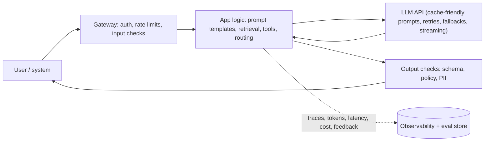

# 29. Evaluation & Production

!!! abstract "In this chapter"
    **Prerequisites:** [Ch. 3](../math/probability.md) (CLT, confidence intervals), [Ch. 21](../frontier/post-training.md) (Bradley–Terry), [Ch. 25–28](prompting.md). **You will learn:** why evaluation is the core engineering discipline of LLM applications; how to build an evaluation set; graders, from exact match to LLM-as-judge, and how to calibrate judges against humans; the statistics of evals (confidence intervals, paired tests, sample sizes, repeated sampling); what public benchmarks measure and how arenas rank models; production architecture, observability and online evaluation; cost and latency engineering; safety, security and governance; and a launch checklist.
    **Why it matters:** LLM outputs are stochastic, open-ended and sensitive to small changes in prompts, models and data. Without measurement you can't tell whether a change helped, whether a new model is safe to switch to, or whether production quality is drifting. Teams that ship reliable LLM products are, first of all, teams with good evals.

!!! watch "Read"
    - Anthropic, [Define success criteria and build evaluations](https://platform.claude.com/docs/en/test-and-evaluate/develop-tests) (docs).
    - H. Husain, [Your AI Product Needs Evals](https://hamel.dev/blog/posts/evals/) and [A Field Guide to Rapidly Improving AI Products](https://hamel.dev/blog/posts/field-guide/), practical and widely followed.
    - E. Miller (Anthropic), [Adding Error Bars to Evals: A Statistical Approach to Language Model Evaluations](https://arxiv.org/abs/2411.00640) (2024).
    - L. Zheng et al., [Judging LLM-as-a-Judge with MT-Bench and Chatbot Arena](https://arxiv.org/abs/2306.05685) (2023).

---

## 29.1 Eval-driven development

The workflow of a mature LLM team:

1. **Define success** in measurable terms for the product: correct field extraction rate, resolution rate, groundedness, format compliance, latency at p95, cost per task.
2. **Build an evaluation set** before optimizing (§29.2).
3. **Measure the baseline**, then change one thing at a time (prompt, model, retrieval, tools) and re-measure.
4. **Look at the data.** Read failures, categorize them (an *error analysis*), and fix the biggest category first. This step produces most of the improvement.
5. **Gate releases** on the eval: no prompt or model change ships if it regresses the suite.
6. **Monitor in production** and feed new failures back into the eval set.

Remember Goodhart's law (§21.9): when a measure becomes a target, it stops being a good measure. Keep evals representative of real use, refresh them, and keep a held-out set you don't tune on.

## 29.2 Building an evaluation set

- **Sources**: real (anonymized) user inputs, sampled to reflect actual traffic; known failure cases; edge cases (empty input, very long input, other languages, ambiguous requests); adversarial cases (prompt injections, attempts to extract the system prompt, policy-violating requests); and synthetic inputs generated by an LLM to fill gaps, reviewed by people.
- **Expected outputs or criteria**: a reference answer, the set of correct labels, unit tests, or a rubric of what a good response must and must not contain.
- **Size**: 50–100 examples catch large regressions and are enough to start. Detecting small differences reliably needs hundreds to thousands (§29.4).
- **Splits**: a development set you iterate on, and a held-out test set you check rarely, so you don't overfit prompts to your own examples.
- **Versioning**: store the eval set, the grader and each run's results alongside the prompt and model version.

## 29.3 Graders

| Grader | How | Good for | Caveats |
|---|---|---|---|
| **Exact / programmatic** | string match, regex, JSON schema, numeric tolerance, unit tests, SQL execution | classification, extraction, code, math | needs a well-defined answer |
| **Reference-based similarity** | compare with a reference answer (overlap, embeddings) | rough signal for free text | weak correlation with quality |
| **LLM-as-judge** | a model scores the output against a rubric, or compares two outputs | open-ended quality: helpfulness, tone, groundedness, instruction following | biased, must be calibrated |
| **Human review** | domain experts rate or compare | the ground truth for subjective quality | slow and expensive; inconsistent without guidelines |

### LLM-as-judge

A strong model can grade at scale. Zheng et al. found GPT-4's judgments agreed with human experts about as often as experts agreed with each other (over 80%). Known biases:

- **Position bias**: in pairwise comparisons, preferring the first (or second) answer. Mitigate by evaluating both orders and averaging.
- **Verbosity bias**: preferring longer answers. Use rubrics that reward completeness and conciseness explicitly.
- **Self-preference**: favoring outputs from the same model family.
- **Leniency** on wrong-but-confident answers without a reference.

Good practice: give the judge a **specific rubric** with concrete criteria and examples of each score; prefer **binary or low-cardinality** judgments ("Does the answer contain any claim not supported by the sources? yes/no") over 1–10 scales; ask for a short justification *before* the verdict; give the judge the reference answer or source documents when they exist; use a capable model; and **calibrate** it against human labels on 100–200 examples.

Measure agreement with **Cohen's kappa**, which corrects raw agreement for chance:

$$
\kappa = \frac{p_o-p_e}{1-p_e},
$$

where $p_o$ is the observed agreement rate and $p_e$ the agreement expected if both raters labeled independently at their own base rates. $\kappa>0.6$ is usually considered substantial agreement. If the judge disagrees with humans, read the disagreements and fix the rubric (or the human guidelines).

## 29.4 The statistics of evals

An eval score is an estimate from a sample, with sampling error, exactly as in §3.6. Treat it that way.

!!! theorem "Proposition 29.1 (Standard error of an accuracy)"
    If $n$ eval questions are an i.i.d. sample and the model answers each correctly with probability $p$, the observed accuracy $\hat p$ has standard error $\sqrt{p(1-p)/n}$, and $\hat p\pm1.96\sqrt{\hat p(1-\hat p)/n}$ is an approximate 95% confidence interval.

??? proof "Proof"
    $\hat p = \frac1n\sum_iX_i$ with $X_i\sim\text{Bernoulli}(p)$ independent, so $\Var\hat p = \frac{p(1-p)}{n}$ (variances of independent sums add, §3.4). By the CLT (Thm 3.7), $\hat p$ is approximately normal, so $\pm1.96$ standard errors cover 95%. $\blacksquare$

    For small $n$ or accuracies near 0 or 1, use the **Wilson interval**, $\dfrac{\hat p+\frac{z^2}{2n}\pm z\sqrt{\frac{\hat p(1-\hat p)}{n}+\frac{z^2}{4n^2}}}{1+\frac{z^2}{n}}$, which stays inside $[0,1]$.

With $n = 200$ and $\hat p = 0.85$, the standard error is $0.025$: the 95% interval is roughly $[0.80, 0.90]$. A change from 85% to 87% on 200 questions is **noise**.

**Compare models on the same questions (paired).** Most of the variance comes from question difficulty, which is shared by both models. Count the questions where only model A is right ($b$) and only model B is right ($c$). Under the null hypothesis of equal accuracy, **McNemar's test** statistic

$$
z = \frac{b-c}{\sqrt{b+c}}
$$

is approximately standard normal. Paired comparisons often need several times fewer questions than comparing two independent accuracies. A paired bootstrap over questions works for any metric.

**How many examples do you need?** To detect a difference $\delta$ between two *independent* accuracies near $p$ with 95% confidence and 80% power, you need about $n\approx\frac{(1.96+0.84)^2\cdot2p(1-p)}{\delta^2}$ per model. For $p = 0.8$ and $\delta = 0.03$, that's about 2,800 questions. Pairing reduces this a lot, but small improvements still need large eval sets.

**Repeated sampling.** Outputs vary from run to run (§18.6). Run each question $k$ times and average, which reduces the within-question variance, and report the mean with its standard error. Miller (2024) also recommends **clustered standard errors** when questions come in groups (several questions about the same document), because grouped questions aren't independent.

## 29.5 Public benchmarks and arenas

| Area | Benchmarks (examples) |
|---|---|
| Knowledge | MMLU / MMLU-Pro, GPQA Diamond (graduate-level science, "Google-proof"), Humanity's Last Exam |
| Math | GSM8K (saturated), MATH, AIME, FrontierMath |
| Code | HumanEval (saturated), LiveCodeBench (contamination-resistant: new problems over time), SWE-bench Verified |
| Agents | SWE-bench, Terminal-Bench, τ-bench, OSWorld, GAIA, BrowseComp (§27.10) |
| Abstraction | ARC-AGI |
| Long context | RULER, needle-in-a-haystack variants, long-document QA |
| Preferences | Chatbot Arena / LMArena |

**Arenas.** In [Chatbot Arena](https://lmarena.ai/) ([Chiang et al., 2024](https://arxiv.org/abs/2403.04132)), users chat with two anonymous models side by side and vote for the better response. Rankings come from fitting the **Bradley–Terry model** of §21.3 to millions of votes: $\Pr(i\succ j) = \sigma(\theta_i-\theta_j)$, reported on an Elo-like scale. It measures what users prefer, which correlates with, but isn't the same as, correctness. Style (length, formatting) influences votes, so arenas now offer style-controlled rankings.

Caveats for all public benchmarks: **contamination** (test questions leaking into training data), **saturation** (top models near the ceiling), and **mismatch** with your task. Use them to shortlist models; decide with your own evals.

## 29.6 Production architecture

Components and practices:

- **Prompt and model versioning**: prompts live in source control with IDs; every logged call records the prompt version and the exact model ID.
- **Routing**: send easy requests to a small model and hard ones to a large one, or vary effort by route (§28.5), validated with evals.
- **Resilience**: timeouts, retries with backoff (the SDK does this for transient errors), fallbacks to another model or a degraded mode, circuit breakers, and queueing for rate limits.
- **Streaming** for interactive use (Ch. 28).
- **Observability**: log inputs, outputs, tool calls, token counts, latency (time to first token and total), cost and errors for every request, with tracing across multi-step chains and agents (OpenTelemetry is the standard). Dashboards per route: volume, p50/p95 latency, cost, error rate, refusal rate.
- **Online evaluation**: run cheap graders (format checks, LLM-judge spot checks) on a sample of live traffic; collect explicit (thumbs) and implicit feedback (edits, retries, escalations to humans); A/B-test prompt and model changes on real traffic with pre-registered metrics.
- **Model upgrades**: run the full eval suite on a new model version before switching, re-tune prompts and effort (§25.2), and roll out gradually.
- **Privacy**: minimize and redact personal data in prompts and logs, set retention policies, and know your provider's data-handling terms.

## 29.7 Cost and latency engineering

Ordered roughly by impact for typical applications:

1. **Prompt caching**: stable prefix first (§28.8). Often halves input cost and cuts time to first token.
2. **Right-size the model and the effort level** per route, measured on evals.
3. **Shorter outputs**: instruct concise answers and use structured formats. Output tokens are the most expensive (§28.13).
4. **Batch API** for anything that isn't interactive: 50% off.
5. **Trim context**: retrieve fewer, better chunks (Ch. 26); compact long histories (§27.8).
6. **Parallelize** independent calls; stream to cut perceived latency.
7. **Cache results** of deterministic or repeated requests at the application layer.

Measure **cost per successful task**: a cheaper model that needs two retries, or a human fix, may cost more.

## 29.8 Safety, security and governance

- **Threats**: prompt injection (§25.5), jailbreaks, data exfiltration through tools, leakage of the system prompt or other users' data, harmful or defamatory output, over-reliance on wrong answers.
- **Controls**: least-privilege tools and sandboxing (§27.9), human approval for consequential actions, input and output filtering, rate limits and abuse monitoring, red-teaming before launch and regularly after, clear user-facing disclosure that responses are AI-generated and can be wrong, and escalation paths to humans.
- **Governance**: document intended use, known limitations and evaluation results (a model or system card); assign owners for quality and safety; keep audit logs. Frameworks such as the [NIST AI Risk Management Framework](https://www.nist.gov/itl/ai-risk-management-framework) and regulation such as the [EU AI Act](https://artificialintelligenceact.eu/) set expectations for risk assessment, transparency and oversight, depending on the use case and jurisdiction.

## 29.9 A launch checklist

- [ ] Success metrics defined; eval set (dev + held-out test) built from realistic and adversarial inputs.
- [ ] Graders validated: programmatic where possible; LLM judges calibrated against human labels.
- [ ] Baseline and confidence intervals measured; improvements tested with paired comparisons.
- [ ] Prompts versioned and cache-friendly; structured outputs where code consumes results.
- [ ] Timeouts, retries, fallbacks, rate-limit handling, and a degraded mode.
- [ ] Logging and tracing with tokens, latency, cost and request IDs; dashboards and alerts.
- [ ] Online evaluation on sampled traffic; user feedback captured.
- [ ] Security review: injection tests, least privilege, sandboxing, confirmation for risky actions.
- [ ] Privacy review: data minimization, redaction, retention.
- [ ] Documentation of limitations; human escalation path; owner on call.
- [ ] Plan for model upgrades: re-run evals, re-tune, gradual rollout.

## 29.10 Where to go from here

You now have the whole stack, from the chain rule to production agents. To keep going:

- **Build** something end to end: a RAG assistant over your team's docs with an eval set, or an agent for a workflow you know, and iterate it with evals.
- **Train** a model: reproduce GPT-2 with build-nanogpt or run nanochat (Ch. 14), then fine-tune an open model with LoRA (Ch. 23) and try DPO or GRPO with TRL (Ch. 21–22).
- **Read papers** as they come out. With this site's foundations, most LLM papers are combinations of ideas you know. The [Resources](../appendix/resources.md) page lists where to follow the field.
- **Revisit** the [Formula Sheet](../appendix/formulas.md) and the exercises. Being able to re-derive things is what understanding means.

## Key takeaways

- Evals are the core discipline: define success, build a representative set, measure, read failures, change one thing at a time, gate releases, monitor.
- Prefer programmatic graders. Use LLM judges with specific rubrics and binary judgments, aware of position, verbosity and self-preference bias, and calibrated against humans (Cohen's κ).
- An accuracy on $n$ questions has standard error $\sqrt{p(1-p)/n}$. Compare models on the same questions (McNemar, paired bootstrap). Small differences need hundreds to thousands of examples. Repeat stochastic runs.
- Public benchmarks shortlist models; arenas rank by human preference via Bradley–Terry. Decide with your own evals.
- In production: version prompts and models, cache, route, retry and fall back, trace everything, evaluate online, and roll out model upgrades behind evals.
- Secure agents with least privilege, sandboxing and human approval. Document limitations and assign ownership.

## Exercises

1. A model scores 72% on a 500-question eval. Give a 95% confidence interval (Wald and Wilson).
2. Models A and B are run on the same 400 questions. A alone is right on 30, B alone on 15. Is A significantly better?
3. A judge and a human agree on 85% of 200 binary labels; the judge says "pass" 70% of the time and the human 60%. Compute Cohen's kappa.
4. How many questions per model would you need to detect a 5-point difference between two independent accuracies near 70% (95% confidence, 80% power)?
5. Design an online-evaluation plan for a RAG assistant: which signals would you log, which graders would you run on sampled traffic, and what would trigger an alert?
6. **Code:** for the triage pipeline from Ch. 28, write a grader and an evaluation script that reports accuracy with a Wilson interval and a per-category confusion matrix.

??? success "Solutions"
    1. SE $=\sqrt{0.72\cdot0.28/500}\approx0.0201$, so Wald gives $[0.681, 0.759]$. Wilson with $z = 1.96$: center $\frac{0.72+0.00384}{1.00768}\approx0.7183$, half-width $\frac{1.96\sqrt{0.000403+0.0000038}}{1.00768}\approx0.0392$, so $[0.679, 0.758]$.
    2. $z = (30-15)/\sqrt{45}\approx2.24>1.96$: significant at the 5% level.
    3. $p_e = 0.7\cdot0.6+0.3\cdot0.4 = 0.54$; $\kappa = (0.85-0.54)/(1-0.54)\approx0.67$, substantial.
    4. $n\approx7.84\cdot2\cdot0.7\cdot0.3/0.05^2\approx1{,}317$ per model.
    5. Log query, retrieved chunk IDs and scores, answer, citations, latency, tokens and cost, and user feedback. On ~5% of traffic run a groundedness judge (are all claims supported by the cited chunks?) and a relevance judge; alert on drops in groundedness or retrieval scores, spikes in "I don't know" or refusals, latency or cost anomalies, and negative-feedback rates.
    6. Use the labeled tickets as the gold set, `messages.parse` for outputs, exact match on category, and the Wilson formula above.

## References

- L. Zheng et al., [Judging LLM-as-a-Judge with MT-Bench and Chatbot Arena](https://arxiv.org/abs/2306.05685) (NeurIPS 2023).
- W.-L. Chiang et al., [Chatbot Arena: An Open Platform for Evaluating LLMs by Human Preference](https://arxiv.org/abs/2403.04132) (ICML 2024).
- E. Miller, [Adding Error Bars to Evals: A Statistical Approach to Language Model Evaluations](https://arxiv.org/abs/2411.00640) (2024).
- P. Liang et al., [Holistic Evaluation of Language Models (HELM)](https://arxiv.org/abs/2211.09110) (2022).
- D. Rein et al., [GPQA: A Graduate-Level Google-Proof Q&A Benchmark](https://arxiv.org/abs/2311.12022) (2023); L. Phan et al., [Humanity's Last Exam](https://arxiv.org/abs/2501.14249) (2025).
- Anthropic, [Define success criteria and build evaluations](https://platform.claude.com/docs/en/test-and-evaluate/develop-tests).
- H. Husain, [Your AI Product Needs Evals](https://hamel.dev/blog/posts/evals/) (2024).
- NIST, [AI Risk Management Framework](https://www.nist.gov/itl/ai-risk-management-framework) (2023).
