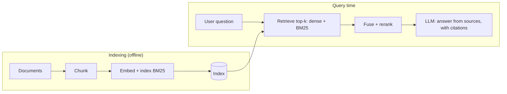

# 26. Embeddings & RAG

!!! abstract "In this chapter"
    **Prerequisites:** [Ch. 1](../math/linear-algebra.md) (dot products, cosine), [Ch. 4](../math/information-theory.md) (mutual information), [Ch. 13](../transformer/block.md) (encoders), [Ch. 25](prompting.md). **You will learn:** why retrieval-augmented generation (RAG) is the standard way to give LLMs knowledge; how embedding models are trained (contrastive InfoNCE loss, and its link to mutual information); BM25 lexical retrieval with each term explained; dense retrieval and approximate nearest-neighbor indexes (HNSW, IVF, product quantization); hybrid search with reciprocal rank fusion; reranking and contextual retrieval; chunking; generating grounded answers with citations; evaluating retrieval (recall@k, MRR, nDCG) and generation (faithfulness); and agentic and long-context alternatives.
    **Why it matters:** most business uses of LLMs need private, current or verifiable knowledge: documentation, tickets, contracts, code, policies. RAG provides it without retraining, with sources you can cite and update the same day.

!!! watch "Read"
    - P. Lewis et al., [Retrieval-Augmented Generation for Knowledge-Intensive NLP Tasks](https://arxiv.org/abs/2005.11401) (2020), the paper that named RAG.
    - Anthropic, [Introducing Contextual Retrieval](https://www.anthropic.com/news/contextual-retrieval) (2024), a practical study of what improves retrieval.
    - S. Robertson & H. Zaragoza, [The Probabilistic Relevance Framework: BM25 and Beyond](https://www.staff.city.ac.uk/~sbrp622/papers/foundations_bm25_review.pdf) (2009).
    - C. Manning, P. Raghavan, H. Schütze, [*Introduction to Information Retrieval*](https://nlp.stanford.edu/IR-book/) (free online), the classic textbook.

---

## 26.1 Why retrieve?

An LLM's parametric knowledge is frozen at training time, incomplete for niche or private topics, and unattributable: the model can't tell you where a fact came from, and it may confidently invent one. **RAG** retrieves relevant passages at query time and puts them in the context, so the model answers from evidence:



Compared with fine-tuning for knowledge (§23.1): facts update by re-indexing, answers can cite sources, access control can be enforced per document, and the model can say "not in the sources".

## 26.2 Embedding models

An **embedding model** maps text to a vector $\mathbf{e}(t)\in\R^d$ (typically $d = 384$–$4096$) such that semantically similar texts have high cosine similarity. Most are Transformer **encoders** (§13.7) or LLMs, with the token vectors pooled (mean or the last token) and normalized. Using the same encoder for queries and documents is a **bi-encoder**: documents can be embedded once, offline.

### Contrastive training: the InfoNCE loss

Training data is pairs $(q_i, d_i^+)$ of a query and a relevant passage (question–answer pairs, title–body, anchor text–page, or synthetic queries generated by an LLM). For a batch of $B$ pairs with similarity $s(q,d) = \mathbf{e}(q)^\top\mathbf{e}(d)$ (unit vectors), the **InfoNCE** loss treats retrieval as a $B$-way classification: which passage in the batch belongs to this query?

$$
\mathcal{L} = -\frac1B\sum_{i=1}^B\log\frac{\exp(s(q_i,d_i^+)/\tau)}{\sum_{j=1}^B\exp(s(q_i,d_j^+)/\tau)}.
$$

The other $B-1$ passages in the batch serve as **in-batch negatives**, for free. That's why embedding models are trained with very large batches. **Hard negatives** (passages that look relevant but aren't, mined with BM25 or an earlier model) are added to sharpen the distinctions. $\tau$ is a temperature (§18.3), typically 0.01–0.05. It's exactly softmax cross-entropy (Thm 4.9) over similarity logits, with gradient $\mathbf{p}-\mathbf{y}$ (Thm 2.8): pull the positive pair together, push the negatives apart in proportion to how confusable they are.

!!! theorem "Fact 26.1 (InfoNCE bounds mutual information)"
    For the InfoNCE loss over $N$ candidates (one positive), $I(Q;D)\ge\log N-\mathcal{L}$ ([van den Oord et al., 2018](https://arxiv.org/abs/1807.03748)). Minimizing the loss maximizes a lower bound on the mutual information (§4.8) between the query and its relevant document, which is why larger batches (larger $N$) allow tighter bounds and better embeddings.

Practical notes: **Matryoshka** training ([Kusupati et al., 2022](https://arxiv.org/abs/2205.13147)) makes prefixes of the embedding (first 256 of 1024 dimensions, say) usable on their own, trading accuracy for storage. Many models expect instruction prefixes ("query: …" vs "passage: …"), so read the model card. Compare models on the [MTEB leaderboard](https://huggingface.co/spaces/mteb/leaderboard), but always validate on *your* data, because leaderboard rankings transfer imperfectly across domains.

## 26.3 Lexical retrieval: BM25

Dense embeddings capture meaning but can miss exact terms: product codes, error messages, names, rare jargon. Lexical retrieval matches words, and **BM25** is the standard. For query terms $t\in Q$ and document $D$:

$$
\operatorname{BM25}(D,Q) = \sum_{t\in Q}\operatorname{IDF}(t)\cdot\frac{f(t,D)\,(k_1+1)}{f(t,D)+k_1\big(1-b+b\frac{|D|}{\text{avgdl}}\big)},\qquad \operatorname{IDF}(t) = \ln\Big(1+\frac{N-n_t+0.5}{n_t+0.5}\Big).
$$

Each piece has a job:

- **IDF**: rare terms (small $n_t$, the number of documents containing $t$) are more informative. It's essentially $\log\frac{1}{p(t)}$, the information content of the term (§4.1).
- **Term-frequency saturation**: the second factor grows with the term count $f$, but approaches $k_1+1$ as $f\to\infty$. The 10th occurrence of a word adds much less than the 1st. With $k_1\approx1.2$–2, a few mentions get most of the credit.
- **Length normalization** ($b\approx0.75$): long documents contain more term occurrences by chance, so their counts are discounted relative to the average document length.

```python
--8<-- "code/rag.py:bm25"
```

## 26.4 Dense retrieval and vector indexes

With unit-normalized embeddings, cosine similarity is a dot product, and retrieval is a matrix–vector product followed by top-k:

```python
--8<-- "code/rag.py:dense"
```

(The `embed` function here is a toy hashing embedding so the tests run offline. Swap in a real embedding model.)

Exact search costs $O(Nd)$ per query, fine for up to a few million vectors on a GPU, or a few hundred thousand on a CPU. Beyond that, **approximate nearest neighbor (ANN)** indexes trade a little recall for orders-of-magnitude speed:

- **HNSW** ([Malkov & Yashunin, 2016](https://arxiv.org/abs/1603.09320)): a multi-layer proximity graph. Search greedily walks toward the query from a sparse top layer down to dense lower layers, visiting roughly $O(\log N)$ nodes. High recall, but memory-heavy. The default in most vector databases.
- **IVF** (inverted file): cluster vectors with k-means and, at query time, search only the few clusters closest to the query.
- **Product quantization (PQ)** ([Jégou et al., 2011](https://ieeexplore.ieee.org/document/5432202)): split each vector into $m$ sub-vectors, quantize each to one of 256 learned centroids (1 byte), and compute approximate distances from lookup tables. A 1024-dimensional fp32 vector (4 KB) becomes, say, 64 bytes.
- Libraries and databases: [FAISS](https://github.com/facebookresearch/faiss), pgvector (Postgres), and dedicated vector databases. Most support metadata filters (tenant, date, permissions), which matter as much as the vector search.

## 26.5 Hybrid search, fusion and reranking

Dense and lexical retrievers fail differently, so combining them is a reliable win. Their scores are on different scales, so fuse **ranks** instead of scores with **reciprocal rank fusion** ([Cormack et al., 2009](https://plg.uwaterloo.ca/~gvcormac/cormacksigir09-rrf.pdf)):

$$
\operatorname{RRF}(d) = \sum_{\text{rankers }r}\frac{1}{k+\operatorname{rank}_r(d)},\qquad k = 60.
$$

```python
--8<-- "code/rag.py:rrf"
```

**Reranking.** Bi-encoders embed queries and documents separately, so they can't model fine-grained interactions between them. A **cross-encoder reranker** reads the query and a candidate passage *together* and outputs a relevance score. That's much more accurate but too slow for the whole corpus, so use it on the top 50–200 candidates from the first stage. (An LLM can also act as a reranker.)

**Contextual retrieval.** Chunks lose their context: "Revenue grew 3% over the previous quarter" doesn't say which company or quarter. Anthropic's [contextual retrieval](https://www.anthropic.com/news/contextual-retrieval) prepends to each chunk a short LLM-written explanation of where it sits in its document before embedding and indexing it. In their experiments, contextual embeddings cut failed retrievals (top-20) by 35%; adding contextual BM25 brought it to 49%; adding reranking, 67%. Prompt caching (Ch. 28) makes generating the contexts cheap, since the whole document is the shared prefix for all of its chunks.

## 26.6 Chunking

Documents are split into chunks small enough to be specific and to fit many into the context, large enough to carry meaning.

```python
--8<-- "code/rag.py:chunk"
```

Guidelines:

- **Size**: a few hundred tokens is a common starting point. Tune it on your evaluation set.
- **Overlap** (10–20%) so facts that straddle a boundary appear whole in at least one chunk (the tests check that chunks cover every word).
- **Respect structure**: split on headings, paragraphs, functions (for code), table rows, rather than raw character counts. Keep the heading path with each chunk ("Billing › Refunds › EU customers").
- **Small-to-big**: retrieve with small chunks for precision, then pass the surrounding section (the "parent") to the LLM for context.
- **Metadata**: source, URL, date, author, access permissions, for filtering and citation.

## 26.7 Generating grounded answers

Put the retrieved chunks in the prompt with identifiers, put the question last (§25.3), and instruct the model to use only the sources, cite them, and say when the answer isn't there. The Claude API has a built-in **citations** feature: pass documents as `document` blocks with citations enabled, and the response's text blocks carry structured citations pointing to the exact cited passages.

```python
import anthropic
from rag import BM25, chunk_text, embed, dense_search, reciprocal_rank_fusion

client = anthropic.Anthropic()

def answer(question, chunks, k=5):
    bm = BM25(chunks)
    lexical = list(bm.scores(question).argsort()[::-1][:20])
    dense, _ = dense_search(embed([question])[0], embed(chunks), k=20)
    top = reciprocal_rank_fusion([lexical, list(dense)])[:k]

    docs = [{"type": "document",
             "source": {"type": "text", "media_type": "text/plain", "data": chunks[i]},
             "title": f"chunk {i}",
             "citations": {"enabled": True}} for i in top]
    response = client.messages.create(
        model="claude-opus-5-5",
        max_tokens=4096,
        system="Answer using only the provided documents. If they don't contain the answer, say so.",
        messages=[{"role": "user", "content": docs + [{"type": "text", "text": question}]}],
    )
    for block in response.content:
        if block.type == "text":
            print(block.text, [c.cited_text for c in (block.citations or [])])
```

**Common failure modes**: the right chunk wasn't retrieved (a retrieval problem: measure recall); it was retrieved but ignored or misread (a generation problem: measure faithfulness); the question needs information spread across many chunks (consider agentic retrieval or larger contexts); the sources conflict or are stale (add dates and tell the model how to resolve conflicts).

## 26.8 Evaluating RAG

Evaluate retrieval and generation **separately**, so you know which to fix. Build a gold set of questions with their relevant passages (sample real user questions; have domain experts label them, or bootstrap with an LLM and verify).

**Retrieval metrics** for a query whose relevant set is $R$ and ranked results $d_1, d_2,\dots$:

$$
\text{Recall@}k = \frac{|R\cap\{d_1..d_k\}|}{|R|},\qquad \text{MRR} = \frac{1}{|\mathcal{Q}|}\sum_{q\in\mathcal{Q}}\frac{1}{\operatorname{rank}_q(\text{first relevant})},
$$

$$
\text{nDCG@}k = \frac{\text{DCG@}k}{\text{IDCG@}k},\qquad \text{DCG@}k = \sum_{i=1}^k\frac{2^{\text{rel}_i}-1}{\log_2(i+1)},
$$

where IDCG is the DCG of the ideal ordering. Recall@k is usually the most important number for RAG: if the answer isn't in the top $k$, the generator can't use it.

**Generation metrics**: *faithfulness* (is every claim supported by the retrieved sources?), *answer relevance* (does it answer the question?), *correctness* against a reference answer, and *citation accuracy*. These are usually scored by an LLM judge with a rubric, calibrated against human labels (Ch. 29). Frameworks such as RAGAS package these metrics.

## 26.9 Beyond basic RAG

- **Query rewriting**: rewrite conversational follow-ups ("what about for EU customers?") into standalone queries, or expand them into several queries.
- **HyDE** ([Gao et al., 2022](https://arxiv.org/abs/2212.10496)): have the LLM write a hypothetical answer and embed *that* for search, since answers look more like documents than questions do.
- **Agentic retrieval**: give the model search as a **tool** (Ch. 27) and let it decide what to search, read results, refine and search again. Multi-hop questions ("which of our customers in Germany use the feature that was deprecated in v3?") need this. It's how modern research assistants and coding agents work: grep and file reads are retrieval tools too.
- **GraphRAG** ([Edge et al., 2024](https://arxiv.org/abs/2404.16130)): build an entity–relation graph and community summaries from the corpus, for questions about the corpus as a whole ("what are the main themes?").
- **Long context vs RAG**: with 1M-token windows, small corpora can simply be put in the context (with prompt caching to make repeated queries cheap). RAG still wins when the corpus is large, changes often, needs per-user access control, or when latency and cost per query matter. Many systems combine them: retrieve generously, then let a long-context model read everything retrieved.

## Key takeaways

- RAG = retrieve relevant passages at query time and answer from them with citations. It's the default way to give LLMs private or current knowledge.
- Embedding models are trained with InfoNCE: softmax cross-entropy over similarities with in-batch and hard negatives, a lower bound on mutual information.
- BM25 = IDF × saturating term frequency × length normalization. It catches exact terms that dense search misses.
- ANN indexes (HNSW, IVF, PQ) make dense search scale. Hybrid retrieval + RRF + a cross-encoder reranker is a strong default. Contextual retrieval adds document context to each chunk.
- Chunk by structure with overlap and metadata. Evaluate retrieval (recall@k, MRR, nDCG) separately from generation (faithfulness, correctness).
- For multi-hop questions, make retrieval a tool an agent can use iteratively.

## Exercises

1. Show that for unit vectors, ranking by cosine similarity, by dot product, and by Euclidean distance give the same order.
2. In the BM25 formula, show that the term-frequency factor is increasing in $f$ and bounded by $k_1+1$. What do $b = 0$ and $b = 1$ mean?
3. Compute RRF scores ($k = 60$) for documents A, B, C with rankings [A, B, C] from BM25 and [C, A, B] from dense search.
4. A query has 2 relevant documents, retrieved at ranks 3 and 7. Compute recall@5, recall@10, the reciprocal rank, and nDCG@10 with binary relevance.
5. Why does InfoNCE with in-batch negatives make large batches important? What happens with batch size 2?
6. **Code:** build a RAG system over this site's Markdown files using `rag.py` and the Claude API. Write 20 questions with known answers and measure recall@5 for BM25, dense, and hybrid retrieval.

??? success "Solutions"
    1. $\lVert\mathbf{a}-\mathbf{b}\rVert^2 = 2-2\mathbf{a}^\top\mathbf{b}$ for unit vectors, a decreasing function of the dot product, which equals the cosine.
    2. $\frac{d}{df}\frac{f(k_1+1)}{f+K} = \frac{(k_1+1)K}{(f+K)^2}>0$ with $K = k_1(1-b+b|D|/\text{avgdl})>0$, and the limit as $f\to\infty$ is $k_1+1$. $b = 0$: no length normalization; $b = 1$: full normalization by relative length.
    3. A: $\frac1{61}+\frac1{62}\approx0.03252$; B: $\frac1{62}+\frac1{63}\approx0.03200$; C: $\frac1{63}+\frac1{61}\approx0.03227$. Order: A, C, B.
    4. Recall@5 = 0.5; recall@10 = 1.0; RR = 1/3. DCG = $\frac{1}{\log_24}+\frac1{\log_28} = 0.5+0.333 = 0.833$; IDCG = $1+\frac1{\log_23} = 1.631$; nDCG ≈ 0.511.
    5. Each query sees $B-1$ negatives. With $B = 2$, it only has to beat one random passage, which is too easy to learn fine distinctions, and the MI bound $\log N$ is only $\log2$.
    6. Typically hybrid ≥ max(BM25, dense), with BM25 strong on queries with exact technical terms.

## References

- P. Lewis et al., [Retrieval-Augmented Generation for Knowledge-Intensive NLP Tasks](https://arxiv.org/abs/2005.11401) (NeurIPS 2020).
- V. Karpukhin et al., [Dense Passage Retrieval for Open-Domain Question Answering](https://arxiv.org/abs/2004.04906) (EMNLP 2020).
- A. van den Oord, Y. Li, O. Vinyals, [Representation Learning with Contrastive Predictive Coding](https://arxiv.org/abs/1807.03748) (2018).
- S. Robertson & H. Zaragoza, The Probabilistic Relevance Framework: BM25 and Beyond, *Foundations and Trends in IR* 3(4) (2009).
- Y. Malkov & D. Yashunin, [Efficient and robust approximate nearest neighbor search using HNSW graphs](https://arxiv.org/abs/1603.09320) (2016); J. Johnson, M. Douze, H. Jégou, [Billion-scale similarity search with GPUs (FAISS)](https://arxiv.org/abs/1702.08734) (2017).
- G. Cormack, C. Clarke, S. Büttcher, Reciprocal Rank Fusion outperforms Condorcet and individual Rank Learning Methods (SIGIR 2009).
- Anthropic, [Introducing Contextual Retrieval](https://www.anthropic.com/news/contextual-retrieval) (2024).
- N. Muennighoff et al., [MTEB: Massive Text Embedding Benchmark](https://arxiv.org/abs/2210.07316) (EACL 2023).
