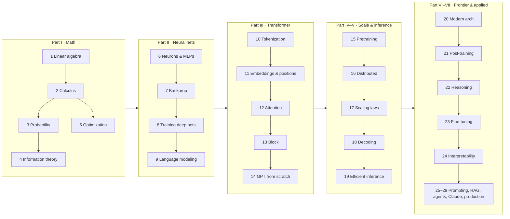

---
hide:
  - navigation
---

# LLM Deep Dive

**From first principles to frontier models: the math, the proofs, the code, and how to use it.**

This site is a structured path to understanding modern large language models (LLMs) completely. It doesn't stop at "attention is a weighted average". The goal is that you can **derive every equation, implement every layer, and reason about every engineering trade-off**, from the chain rule all the way to Claude-class models, RLHF, reasoning models, and production agents.

It's written for an experienced software engineer. It assumes you can program and are comfortable learning math, but it **doesn't** assume you remember any linear algebra, calculus, or probability. Everything is rebuilt from the ground up, in an order where each idea uses only ideas already established.

!!! tip "How this site is different"
    - **Proofs, not just results.** Every key formula is derived step by step: why softmax-cross-entropy has gradient $\mathbf{p} - \mathbf{y}$, why attention divides by $\sqrt{d_h}$, why Chinchilla says ~20 tokens per parameter, why DPO's loss follows from the RLHF objective.
    - **Tested code.** Every major component (autograd, manual backprop, n-gram and MLP language models, BPE, attention, GPT-2, a Llama-style model with KV cache, mixture-of-experts, LoRA, DPO/GRPO, quantization, sparse autoencoders, retrieval) lives in [`code/`](https://github.com/kdellis135/llm_deep_dive/tree/main/code) as runnable Python, with [60 automated checks](https://github.com/kdellis135/llm_deep_dive/blob/main/code/test_all.py), most of them against PyTorch reference implementations or known exact answers. The code you read on the page is the code that was tested.
    - **Interactive.** Widgets let you drag matrices, race optimizers, change softmax temperature, inspect attention heads, rotate RoPE vectors, run BPE merges, and size KV caches.
    - **Curated videos.** Each chapter links the best explanations available, especially [Andrej Karpathy's *Neural Networks: Zero to Hero*](https://www.youtube.com/playlist?list=PLAqhIrjkxbuWI23v9cThsA9GvCAUhRvKZ) and [3Blue1Brown](https://www.youtube.com/@3blue1brown), placed where they help most.
    - **Theory → practice.** The last part covers how to actually use LLMs in business: prompting, RAG, agents, the Claude API, fine-tuning decisions, evals, and cost/latency engineering.

## The roadmap

| Part | Chapters | You will be able to… |
|---|---|---|
| **Start here** | [Setup](start/setup.md), [Notation](start/notation.md) | Run all code; read every formula on this site unambiguously |
| **I · Math foundations** | 1–5 | Manipulate vectors, matrices, gradients, Jacobians, distributions, entropy, KL; prove convergence of gradient descent; derive Adam |
| **II · Neural networks** | 6–9 | Build an autograd engine; derive backprop by hand; explain initialization and normalization from variance arguments; train an n-gram, MLP and RNN language model |
| **III · The Transformer** | 10–14 | Implement BPE, embeddings, RoPE, attention, the full block, and GPT-2 (124M) from an empty file |
| **IV · Training at scale** | 15–17 | Estimate FLOPs and memory; explain data/tensor/pipeline parallelism, ZeRO, mixed precision; derive compute-optimal scaling |
| **V · Inference** | 18–19 | Implement sampling strategies, KV caching, FlashAttention's online softmax, quantization, speculative decoding |
| **VI · Frontier models** | 20–24 | Explain Llama/DeepSeek/MoE design choices; derive RLHF, PPO, DPO, GRPO; understand reasoning models; fine-tune with LoRA/QLoRA; read interpretability research |
| **VII · Applying LLMs** | 25–29 | Engineer prompts and context; build RAG and agents; use the Claude API well (tools, caching, thinking, structured output); evaluate and operate LLM systems |

## How to read this site

1. **Go in order the first time.** Each chapter lists its prerequisites at the top, and later chapters refer back to earlier ones by number ("see §2.4").
2. **Do the derivations with a pen.** Proofs are in collapsible blocks. Try to prove the result yourself first, then open the block.
3. **Run the code.** Clone the repo, run `python code/test_all.py`, then change things and break them.
4. **Watch the linked videos** when a concept doesn't click. They're placed where they add the most.
5. **Do the exercises.** Each chapter ends with exercises, and the solutions are collapsible.

!!! llm "The one-sentence summary of an LLM"
    An LLM is a function $p_\theta(x_{t} \mid x_{<t})$, a **Transformer** with parameters $\theta$, trained by **gradient descent** to minimize the **cross-entropy** of predicting the next **token** on trillions of tokens of text, then **post-trained** with supervised examples and **reinforcement learning** to be a helpful, honest, harmless assistant, and finally **sampled** one token at a time at inference.

    Every bolded word is a chapter of this site. By the end you'll understand each one completely.

## Primary sources this site is built on

The explanations here follow the authoritative sources: original papers (linked by arXiv ID throughout), standard textbooks (Goodfellow et al., *Deep Learning*; Deisenroth et al., *Mathematics for Machine Learning*; Prince, *Understanding Deep Learning*; Cover & Thomas, *Elements of Information Theory*; Boyd & Vandenberghe, *Convex Optimization*), Karpathy's code (micrograd, makemore, nanoGPT, minbpe, build-nanogpt, nanochat), and official documentation from Anthropic, PyTorch and Hugging Face. See [Resources](appendix/resources.md) for the full list.
