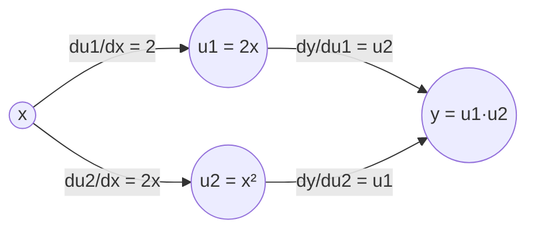

# 2. Calculus & Matrix Calculus

!!! abstract "In this chapter"
    **Prerequisites:** [Ch. 1](linear-algebra.md) (vectors, matrices, dot products, transpose). No prior calculus is assumed: we start from slopes.

    **You will learn:**

    - derivatives as "best linear approximations", from the definition up
    - the chain rule (with proof) and why it is the heart of backprop
    - gradients and why they point uphill
    - Jacobians and vector–Jacobian products
    - every matrix-calculus identity a Transformer needs: linear layers, softmax, cross-entropy
    - Taylor expansions, the Hessian, convexity
    - numerical gradient checking, and just enough integration for probability

    **Why it matters:** training = following gradients. Backpropagation (Ch. 7) is *nothing but* the chain rule applied to a computation graph, organized as vector–Jacobian products. If you know this chapter, you can derive the gradient of any layer by hand.

!!! watch "Watch"
    3Blue1Brown, *Essence of Calculus*. Start with [Visualizing the chain rule and product rule](https://www.youtube.com/watch?v=YG15m2VwSjA).

    <div class="video"><iframe src="https://www.youtube-nocookie.com/embed/videoseries?list=PLZHQObOWTQDMsr9K-rj53DwVRMYO3t5Yr" allowfullscreen loading="lazy"></iframe></div>

    Reading: T. Parr & J. Howard, [*The Matrix Calculus You Need For Deep Learning*](https://arxiv.org/abs/1802.01528) (2018); Deisenroth et al., [*MML*](https://mml-book.github.io/) Ch. 5.

!!! tip "Reading this chapter"
    Same format as Ch. 1: idea → definition → worked example → theorem → numbered proof steps. Do the worked examples with a pen. Every formula used later in the site is derived here, with no steps skipped.

---

## Roadmap

| § | Question it answers | Used later in |
|---|---|---|
| Warm-up | What is a slope, and what is a limit? | everything below |
| 2.1 | What is a derivative? | all of training |
| 2.2 | How do slopes combine through a chain of functions? | backprop (Ch. 7) |
| 2.3 | What is a gradient and why does it point uphill? | gradient descent (Ch. 5) |
| 2.4 | How does the chain rule work with vectors? | backprop, autograd |
| 2.5 | What are the gradients of linear layers, softmax, cross-entropy? | every LLM |
| 2.6 | What does curvature tell us? | learning-rate limits (Ch. 5) |
| 2.7 | How do we check a gradient numerically? | debugging (Ch. 7) |
| 2.8 | What is an integral? | probability densities (Ch. 3) |

---

## Warm-up: slopes and limits

### The slope of a line

For a straight line, the **slope** is "rise over run": how much the output changes per unit of input.

$$
\text{slope} = \frac{\text{change in output}}{\text{change in input}} = \frac{f(b) - f(a)}{b - a}.
$$

For $f(x) = 3x + 1$, going from $x=1$ to $x=2$, the output goes from $4$ to $7$. Slope $= 3/1 = 3$. It is $3$ everywhere: that's what "straight" means.

### The slope of a curve

A curve like $f(x) = x^2$ has a different steepness at every point. To find the steepness at $x = 3$, take a nearby point $3 + h$ and compute the slope between them. Then shrink $h$:

| $h$ | $f(3+h)$ | slope $\dfrac{f(3+h)-f(3)}{h}$ |
|---|---|---|
| $1$ | $16$ | $\frac{16-9}{1} = 7$ |
| $0.1$ | $9.61$ | $\frac{0.61}{0.1} = 6.1$ |
| $0.01$ | $9.0601$ | $\frac{0.0601}{0.01} = 6.01$ |
| $0.001$ | $9.006001$ | $6.001$ |

The slopes approach $6$. We say **the limit as $h\to0$ is 6**, written $\lim_{h\to0}(\dots) = 6$.

A **limit** is the value an expression gets arbitrarily close to as $h$ gets close to $0$. We never plug in $h = 0$ itself (that would be $0/0$).

---

## 2.1 The derivative is the best linear approximation

**The idea:** zoom in far enough on a smooth curve and it looks like a straight line. The derivative is that line's slope.

!!! definition "Definition 2.1 (Derivative)"
    $f:\R\to\R$ is **differentiable** at $x$ if this limit exists:

    $$
    f'(x) = \lim_{h\to0}\frac{f(x+h)-f(x)}{h}.
    $$

    Equivalently,

    $$
    f(x+h) = f(x) + f'(x)\,h + o(h),
    $$

    where $o(h)$ ("little-o of $h$") stands for an error that shrinks *faster* than $h$: $o(h)/h\to0$.

!!! recall "What “shrinks faster than $h$” means"
    $h^2$ is a typical $o(h)$ term. As $h$ shrinks, $h^2$ becomes negligible *even compared with* $h$:

    | $h$ | $h^2$ | $h^2 / h$ |
    |---|---|---|
    | $0.1$ | $0.01$ | $0.1$ |
    | $0.01$ | $0.0001$ | $0.01$ |
    | $0.001$ | $0.000001$ | $0.001$ |

    The ratio goes to 0, so $h^2 = o(h)$. Any product of $o(h)$ with a bounded number is also $o(h)$.

The second form is the one to remember:

> **Near $x$, $f$ looks like a line with slope $f'(x)$.** If I nudge the input by $h$, the output moves by about $f'(x)\cdot h$.

!!! example "Worked example: $f(x) = x^2$ from the definition"
    **Step 1 · Expand** $f(x+h) = (x+h)^2 = x^2 + 2xh + h^2$.

    **Step 2 · Subtract and divide:**

    $$
    \frac{f(x+h)-f(x)}{h} = \frac{2xh + h^2}{h} = 2x + h .
    $$

    **Step 3 · Let $h\to0$:** the slope is $f'(x) = 2x$.

    At $x = 3$ that's $6$, matching the table in the warm-up. In the second form: $(x+h)^2 = x^2 + \underbrace{2x}_{f'(x)}h + \underbrace{h^2}_{o(h)}$.

### The derivatives you need

Each line in this table is derived in the box underneath.

| $f(x)$ | $f'(x)$ | Where it shows up |
|---|---|---|
| $c$ (a constant) | $0$ | biases, constants |
| $x^n$ | $nx^{n-1}$ | squared errors, norms |
| $e^x$ | $e^x$ | softmax |
| $\log x$ | $1/x$ | log-likelihood, cross-entropy |
| $\sigma(x)=\frac{1}{1+e^{-x}}$ | $\sigma(x)(1-\sigma(x))$ | gates, SiLU/SwiGLU |
| $\tanh x$ | $1-\tanh^2x$ | GELU approximation, micrograd |

And the rules for combining functions:

| Rule | Formula |
|---|---|
| Sum | $(f+g)' = f' + g'$ |
| Constant multiple | $(cf)' = c\,f'$ |
| Product | $(fg)' = f'g + fg'$ |
| Chain (§2.2) | $(f(g(x)))' = f'(g(x))\,g'(x)$ |
| Quotient (§2.2) | $\left(\dfrac{f}{g}\right)' = \dfrac{f'g - fg'}{g^2}$ |

??? proof "Where the basic derivatives come from"
    **Powers, $x^n$.** Multiplying out $(x+h)^n$ gives $x^n + n\,x^{n-1}h + (\text{terms with } h^2, h^3, \dots)$. The binomial theorem says the $h$ term has coefficient $n$, because there are $n$ ways to pick one $h$ from the $n$ factors. The $h^2$-and-higher terms are $o(h)$. So $f'(x) = nx^{n-1}$.

    **Exponential, $e^x$.** $e^{x+h} - e^x = e^x(e^h - 1)$. The number $e\approx2.718$ is *defined* as the base for which $(e^h-1)/h\to1$:

    | $h$ | $(e^h-1)/h$ |
    |---|---|
    | $0.1$ | $1.0517$ |
    | $0.01$ | $1.0050$ |
    | $0.001$ | $1.0005$ |

    So $\frac{e^{x+h}-e^x}{h} = e^x\cdot\frac{e^h-1}{h}\to e^x$. The exponential is its own derivative.

    **Logarithm, $\log x$** (natural log, base $e$). It's the inverse of $e^x$: $e^{\log x} = x$. Differentiate both sides with the chain rule (§2.2): $e^{\log x}\cdot(\log x)' = 1$, i.e. $x\cdot(\log x)' = 1$, so $(\log x)' = 1/x$.

    **Sigmoid and tanh** are worked out in §2.2 and Exercise 1.

???+ proof "Proof of the product rule"
    **Step 1 · Write both functions in linear-approximation form:**

    $$
    f(x+h) = f + f'h + o(h), \qquad g(x+h) = g + g'h + o(h).
    $$

    **Step 2 · Multiply them out:**

    $$
    f(x+h)\,g(x+h) = fg + (f'g + fg')\,h + \underbrace{f'g'h^2 + (\text{terms with } o(h))}_{o(h)} .
    $$

    **Step 3 · Read off the coefficient of $h$.** It's $f'g + fg'$. By Definition 2.1, that coefficient is the derivative. $\blacksquare$

---

## 2.2 The chain rule

**The idea:** when functions are chained, their slopes multiply.

> If $u$ changes 3× as fast as $x$, and $y$ changes 2× as fast as $u$, then $y$ changes $3\times2 = 6$× as fast as $x$.

!!! theorem "Theorem 2.1 (Chain rule)"
    If $g$ is differentiable at $x$ and $f$ is differentiable at $g(x)$, then

    $$
    (f\circ g)'(x) = f'(g(x))\,g'(x).
    $$

    ($f\circ g$ means "apply $g$, then $f$": $(f\circ g)(x) = f(g(x))$.)

???+ proof "Proof (via linear approximations)"
    **Step 1 · Name the inner change.** Let $u = g(x)$, and let $k$ be how much the inner function moves when $x$ moves by $h$:

    $$
    k = g(x+h)-g(x) = g'(x)\,h + o(h).
    $$

    **Step 2 · Linearize the outer function** at $u$, with step $k$:

    $$
    f(g(x+h)) = f(u + k) = f(u) + f'(u)\,k + o(k).
    $$

    **Step 3 · Substitute $k$:**

    $$
    = f(u) + f'(u)\,g'(x)\,h + \underbrace{f'(u)\,o(h) + o(k)}_{\text{both } o(h)} .
    $$

    Why are both error terms $o(h)$? The first is a constant times $o(h)$. For the second: $k$ is roughly proportional to $h$, so anything shrinking faster than $k$ also shrinks faster than $h$.

    **Step 4 · Read off the coefficient of $h$:** $f'(g(x))\,g'(x)$. $\blacksquare$

!!! example "Worked example 1: check against expanding"
    $y = (3x+1)^2$. Inner $u = 3x+1$ with $u' = 3$. Outer $y = u^2$ with $dy/du = 2u$.

    - Chain rule: $y' = 2u\cdot3 = 6(3x+1) = 18x + 6$.
    - Expand first: $y = 9x^2 + 6x + 1$, so $y' = 18x + 6$. ✓ Same answer.

!!! example "Worked example 2: $e^{-x}$"
    Inner $u = -x$, $u' = -1$. Outer $e^u$, derivative $e^u$.

    $$
    \frac{d}{dx}e^{-x} = e^{-x}\cdot(-1) = -e^{-x}.
    $$

### The quotient rule

We need it for softmax. It follows from the product and chain rules.

???+ proof "Derivation of the quotient rule"
    **Step 1 · Write the quotient as a product:** $\frac{f}{g} = f\cdot g^{-1}$.

    **Step 2 · Chain rule on $g^{-1}$:** outer $u^{-1}$ has derivative $-u^{-2}$, so $(g^{-1})' = -g^{-2}g'$.

    **Step 3 · Product rule:**

    $$
    \Big(f\cdot g^{-1}\Big)' = f'g^{-1} + f\cdot(-g^{-2}g') = \frac{f'}{g} - \frac{fg'}{g^2} = \frac{f'g - fg'}{g^2}. \qquad\blacksquare
    $$

### The sigmoid

The **sigmoid** $\sigma(x) = \dfrac{1}{1+e^{-x}}$ squashes any number into $(0,1)$. Its derivative has a famously neat form.

!!! theorem "Example 2.2 (Sigmoid derivative)"
    $\sigma'(x) = \sigma(x)\,(1-\sigma(x))$.

???+ proof "Proof"
    **Step 1 · Write it as a power:** $\sigma(x) = (1+e^{-x})^{-1}$.

    **Step 2 · Chain rule.** Outer function $u^{-1}$, derivative $-u^{-2}$. Inner $u = 1+e^{-x}$, derivative $-e^{-x}$ (Worked example 2):

    $$
    \sigma'(x) = -(1+e^{-x})^{-2}\cdot(-e^{-x}) = \frac{e^{-x}}{(1+e^{-x})^2}.
    $$

    **Step 3 · Split the fraction into two factors:**

    $$
    = \frac{1}{1+e^{-x}}\cdot\frac{e^{-x}}{1+e^{-x}} .
    $$

    **Step 4 · Recognize each factor.** The first is $\sigma(x)$. The second is $\frac{(1+e^{-x}) - 1}{1+e^{-x}} = 1 - \sigma(x)$. $\blacksquare$

    **Numbers:** at $x = 0$, $\sigma = 0.5$, so $\sigma' = 0.25$. That's the steepest the sigmoid ever gets.

The derivative is written in terms of the *output* $\sigma(x)$. Backprop implementations exploit this: they store the forward output and reuse it (see `tanh` in micrograd, Ch. 7).

---

## 2.3 Partial derivatives and the gradient

**The idea:** with many inputs, ask "how does the output change if I nudge *one* input?" — for each input. Collect the answers in a vector.

For $f:\R^n\to\R$, the **partial derivative** $\partial f/\partial x_i$ is the ordinary derivative with respect to $x_i$, **treating every other input as a constant**.

!!! example "Worked example: partial derivatives"
    $f(x, y) = x^2y + 3y$.

    | Partial | Treat as constant | Result |
    |---|---|---|
    | $\dfrac{\partial f}{\partial x}$ | $y$ | $2xy$ ($3y$ is a constant, so it vanishes) |
    | $\dfrac{\partial f}{\partial y}$ | $x$ | $x^2 + 3$ |

    At the point $(1, 2)$: $\partial f/\partial x = 4$ and $\partial f/\partial y = 4$.

The **gradient** collects all the partial derivatives into one vector, with the same shape as the input:

$$
\nabla f(\mathbf{x}) = \left(\frac{\partial f}{\partial x_1},\dots,\frac{\partial f}{\partial x_n}\right)^\top\in\R^n .
$$

It gives the multi-input version of the linear approximation. The single slope becomes a dot product:

$$
f(\mathbf{x}+\mathbf{h}) = f(\mathbf{x}) + \nabla f(\mathbf{x})^\top\mathbf{h} + o(\lVert\mathbf{h}\rVert).
$$

!!! example "Worked example: does the approximation work?"
    Same $f$, at $(1, 2)$, where $f = 1\cdot2 + 6 = 8$ and $\nabla f = (4, 4)$. Nudge by $\mathbf{h} = (0.01, 0)$:

    - Prediction: $8 + (4, 4)\cdot(0.01, 0) = 8 + 0.04 = 8.04$.
    - Truth: $f(1.01, 2) = 1.0201\cdot2 + 6 = 8.0402$.

    Off by $0.0002$: an $o(\lVert\mathbf{h}\rVert)$ error.

### Directional derivatives

How fast does $f$ change if we move in some direction $\mathbf{u}$ (a unit vector)? Put $\mathbf{h} = t\mathbf{u}$ in the approximation:

$$
f(\mathbf{x}+t\mathbf{u}) \approx f(\mathbf{x}) + t\,\nabla f^\top\mathbf{u}.
$$

So the rate of change along $\mathbf{u}$, the **directional derivative**, is

$$
D_\mathbf{u}f = \nabla f^\top\mathbf{u}.
$$

Which direction gives the fastest increase?

!!! theorem "Theorem 2.3 (The gradient is the direction of steepest ascent)"
    Among all unit directions $\mathbf{u}$, the directional derivative $D_\mathbf{u}f = \nabla f^\top\mathbf{u}$:

    | Direction | Value | Meaning |
    |---|---|---|
    | $\mathbf{u} = \nabla f/\lVert\nabla f\rVert$ | $+\lVert\nabla f\rVert$ (maximum) | steepest uphill |
    | $\mathbf{u} = -\nabla f/\lVert\nabla f\rVert$ | $-\lVert\nabla f\rVert$ (minimum) | steepest downhill |
    | $\mathbf{u}\perp\nabla f$ | $0$ | along the contour line: no change |

???+ proof "Proof"
    **Step 1 · Cauchy–Schwarz** (Thm 1.2) with $\lVert\mathbf{u}\rVert = 1$:

    $$
    -\lVert\nabla f\rVert \le \nabla f^\top\mathbf{u}\le\lVert\nabla f\rVert .
    $$

    **Step 2 · When is the bound reached?** Equality holds exactly when $\mathbf{u}$ is a multiple of $\nabla f$: positive multiple for the top, negative for the bottom.

    **Step 3 · Perpendicular directions** have $\nabla f^\top\mathbf{u} = 0$ by definition of perpendicular. $\blacksquare$

!!! intuition "Intuition"
    Stand on a hillside in fog.

    - The gradient is the compass direction in which the ground rises fastest.
    - Its length is how steep that is.
    - Contour lines (paths of constant height) are perpendicular to it.

    **Gradient descent** steps the other way:

    $$
    \mathbf{x}\leftarrow\mathbf{x}-\eta\nabla f(\mathbf{x}),
    $$

    where the **learning rate** $\eta$ sets the step size. You'll see this in the optimizer widget in Ch. 5.

!!! example "Worked example: one step of gradient descent"
    $f(x,y) = x^2 + y^2$ (a bowl with its bottom at the origin). Start at $(3, 4)$, where $f = 25$.

    | Step | Value |
    |---|---|
    | gradient $(2x, 2y)$ | $(6, 8)$ |
    | step with $\eta = 0.1$ | $(3, 4) - 0.1\cdot(6,8) = (2.4, 3.2)$ |
    | new loss | $2.4^2 + 3.2^2 = 16$ |

    The loss dropped from 25 to 16, and we moved straight toward the bottom.

---

## 2.4 Jacobians and the multivariate chain rule

**The idea:** when a function has many inputs *and* many outputs, its "derivative" is a matrix of all the partial derivatives.

!!! definition "Jacobian"
    For $\mathbf{f}:\R^n\to\R^m$, the **Jacobian** $\mathbf{J}\in\R^{m\times n}$ has entries

    $$
    J_{ij} = \frac{\partial f_i}{\partial x_j}\qquad(\text{row} = \text{output},\ \text{column} = \text{input}).
    $$

    It is the matrix of the best linear approximation:

    $$
    \mathbf{f}(\mathbf{x}+\mathbf{h}) \approx \mathbf{f}(\mathbf{x}) + \mathbf{J}\mathbf{h}.
    $$

!!! example "Worked example"
    $\mathbf{f}(x, y) = (xy,\; x + y)$. Two outputs, two inputs.

    $$
    \mathbf{J} = \begin{pmatrix}\partial(xy)/\partial x & \partial(xy)/\partial y\\ \partial(x+y)/\partial x & \partial(x+y)/\partial y\end{pmatrix} = \begin{pmatrix}y & x\\ 1 & 1\end{pmatrix}.
    $$

One picture covers every case:

| Function type | "Derivative" | Shape |
|---|---|---|
| $\R\to\R$ | $f'(x)$ | a number |
| $\R^n\to\R$ | gradient $\nabla f$ | vector $n$ (the Jacobian is the $1\times n$ row $\nabla f^\top$) |
| $\R^n\to\R^m$ | Jacobian $\mathbf{J}$ | matrix $m\times n$ |

!!! theorem "Theorem 2.4 (Multivariate chain rule)"
    For $\mathbf{y} = \mathbf{f}(\mathbf{u})$ and $\mathbf{u} = \mathbf{g}(\mathbf{x})$:

    $$
    \frac{\partial\mathbf{y}}{\partial\mathbf{x}} = \frac{\partial\mathbf{y}}{\partial\mathbf{u}}\,\frac{\partial\mathbf{u}}{\partial\mathbf{x}}
    \qquad\text{i.e.}\qquad
    \frac{\partial y_i}{\partial x_j} = \sum_k\frac{\partial y_i}{\partial u_k}\frac{\partial u_k}{\partial x_j}.
    $$

    The influence of $x_j$ on $y_i$ is the **sum over all paths** through the intermediate variables $u_k$. Along each path, slopes multiply.



!!! example "Worked example: sum over paths"
    The graph above: $u_1 = 2x$, $u_2 = x^2$, $y = u_1u_2$.

    | Path | Product of slopes |
    |---|---|
    | $x\to u_1\to y$ | $2\cdot u_2 = 2x^2$ |
    | $x\to u_2\to y$ | $2x\cdot u_1 = 2x\cdot2x = 4x^2$ |
    | **sum** | $6x^2$ |

    **Check:** $y = 2x\cdot x^2 = 2x^3$, so $y' = 6x^2$. ✓

???+ proof "Proof"
    **Step 1 · Linearize the inner map:** $\mathbf{u}(\mathbf{x}+\mathbf{h}) \approx \mathbf{u} + \mathbf{J}_g\mathbf{h}$.

    **Step 2 · Linearize the outer map** with step $\mathbf{J}_g\mathbf{h}$: $\mathbf{y}\approx\mathbf{y}(\mathbf{u}) + \mathbf{J}_f(\mathbf{J}_g\mathbf{h})$.

    **Step 3 · Combine.** Applying two linear maps in a row is multiplying their matrices (Thm 1.5), so the combined linear part is $\mathbf{J}_f\mathbf{J}_g$. The error terms vanish exactly as in Thm 2.1. $\blacksquare$

### The vector–Jacobian product (VJP): the heart of backprop

In deep learning the very last output is a single number: the **loss** $\mathcal{L}$. Suppose $\mathbf{y} = \mathbf{f}(\mathbf{x})$ is one step somewhere inside the network, and we already know how the loss depends on $\mathbf{y}$:

$$
\mathbf{g}_\mathbf{y} = \nabla_\mathbf{y}\mathcal{L}.
$$

We want $\nabla_\mathbf{x}\mathcal{L}$. Derivation, step by step:

1. Apply Theorem 2.4 with the scalar $\mathcal{L}$ as the final output: $\dfrac{\partial\mathcal{L}}{\partial x_j} = \sum_i\dfrac{\partial\mathcal{L}}{\partial y_i}\dfrac{\partial y_i}{\partial x_j} = \sum_i (\mathbf{g}_\mathbf{y})_i\,J_{ij}$.
2. A sum over the *row* index $i$ of $J_{ij}$ is a product with the *transpose*: $\sum_i J_{ij}(\mathbf{g}_\mathbf{y})_i = (\mathbf{J}^\top\mathbf{g}_\mathbf{y})_j$.
3. Stack over all $j$:

$$
\boxed{\;\nabla_\mathbf{x}\mathcal{L} = \mathbf{J}^\top\,\nabla_\mathbf{y}\mathcal{L}\;}
\qquad\text{where } \mathbf{J} = \frac{\partial\mathbf{y}}{\partial\mathbf{x}}.
$$

This is the most important equation in this chapter. Each operation in a network only needs to know one thing: **how to multiply an incoming gradient by its transposed Jacobian.**

**Backprop never builds Jacobians.** That multiplication is usually far cheaper than building $\mathbf{J}$.

!!! example "Worked example: an elementwise function"
    For $y_i = \phi(x_i)$ (like `tanh` applied entry by entry), output $i$ depends only on input $i$. So $\mathbf{J}$ is diagonal: $\mathbf{J} = \diag(\phi'(\mathbf{x}))$.

    The VJP is just an elementwise product: $\nabla_\mathbf{x}\mathcal{L} = \phi'(\mathbf{x})\odot\mathbf{g}_\mathbf{y}$. That's $O(n)$ work instead of an $n\times n$ matrix.

    **Numbers** with $\phi = \tanh$, $\mathbf{x} = (0, 1)$, $\mathbf{g}_\mathbf{y} = (1, 2)$:

    | $i$ | $\tanh'(x_i) = 1-\tanh^2(x_i)$ | $\times\,(\mathbf{g}_\mathbf{y})_i$ |
    |---|---|---|
    | 1 | $1 - 0 = 1$ | $1$ |
    | 2 | $1 - 0.7616^2 = 0.42$ | $0.84$ |

    So $\nabla_\mathbf{x}\mathcal{L} = (1, 0.84)$.

!!! llm "Why reverse mode?"
    A network is a chain of steps, so the full derivative is a product $\mathbf{J}_L\cdots\mathbf{J}_2\mathbf{J}_1$. There are two orders to multiply it in.

    | Order | Each step | Cost for a scalar loss and $n$ parameters |
    |---|---|---|
    | **reverse** (output end first) | vector × matrix | about one forward pass |
    | forward (input end first) | matrix × matrix, or one pass per input | about $n$ forward passes |

    With $n = 10^{11}$ parameters, this is the difference between possible and impossible. This is **reverse-mode automatic differentiation**. Ch. 7 builds it.

---

## 2.5 Matrix calculus you will actually use

All results use the gradient convention from [Notation](../start/notation.md): **$\nabla_\mathbf{W}\mathcal{L}$ has the same shape as $\mathbf{W}$.**

### The one technique

There is a single, reliable recipe. It never requires memorizing a formula:

1. **Write the scalar in index notation** (explicit sums).
2. **Differentiate with respect to one entry** ($x_k$ or $W_{kl}$).
3. **Re-assemble** the entries into a vector or matrix.

Step 2 needs one bookkeeping tool.

!!! recall "The Kronecker delta $\delta_{ij}$"
    $$
    \delta_{ij} = \begin{cases}1 & i = j\\ 0 & i\neq j\end{cases}
    $$

    It is just the entries of the identity matrix. It appears because $\partial x_i/\partial x_k = \delta_{ik}$: $x_i$ depends on $x_k$ only if they're the same variable.

    **The sifting rule:** a sum against $\delta$ picks out one term.

    $$
    \sum_i a_i\,\delta_{ik} = a_k .
    $$

    (Every term is zero except the one where $i = k$.)

!!! theorem "Identities 2.5"
    1. $\nabla_\mathbf{x}(\mathbf{a}^\top\mathbf{x}) = \mathbf{a}$
    2. $\nabla_\mathbf{x}(\mathbf{x}^\top\mathbf{A}\mathbf{x}) = (\mathbf{A}+\mathbf{A}^\top)\mathbf{x}$, which is $2\mathbf{A}\mathbf{x}$ if $\mathbf{A}$ is symmetric
    3. $\nabla_\mathbf{x}\lVert\mathbf{x}\rVert^2 = 2\mathbf{x}$
    4. $\nabla_\mathbf{x}\lVert\mathbf{x}\rVert = \mathbf{x}/\lVert\mathbf{x}\rVert$

    Compare with one variable: $(ax)' = a$, $(ax^2)' = 2ax$, $(x^2)' = 2x$, $(\lvert x\rvert)' = \pm1$.

???+ proof "Proofs (using the recipe)"
    **Identity 1.**

    - *Index form:* $\mathbf{a}^\top\mathbf{x} = \sum_ia_ix_i$.
    - *Differentiate by $x_k$:* $\sum_i a_i\delta_{ik} = a_k$.
    - *Re-assemble:* the vector of $a_k$'s is $\mathbf{a}$.

    **Identity 2.**

    - *Index form:* $\mathbf{x}^\top\mathbf{A}\mathbf{x} = \sum_{i,j}x_iA_{ij}x_j$.
    - *Differentiate by $x_k$ with the product rule:* $x_k$ can appear as $x_i$ or as $x_j$:

    $$
    \frac{\partial}{\partial x_k}\sum_{i,j}x_iA_{ij}x_j = \sum_{i,j}\big(\delta_{ik}A_{ij}x_j + x_iA_{ij}\delta_{jk}\big) = \sum_jA_{kj}x_j + \sum_ix_iA_{ik}.
    $$

    - *Re-assemble:* the first sum is $(\mathbf{A}\mathbf{x})_k$, the second is $(\mathbf{A}^\top\mathbf{x})_k$.

    **Identity 3.** Identity 2 with $\mathbf{A}=\mathbf{I}$: $(\mathbf{I}+\mathbf{I})\mathbf{x} = 2\mathbf{x}$.

    **Identity 4.** Chain rule with $s = \lVert\mathbf{x}\rVert^2$: $\nabla\sqrt{s} = \frac{1}{2\sqrt s}\nabla s = \frac{2\mathbf{x}}{2\lVert\mathbf{x}\rVert}$. $\blacksquare$

!!! example "Sanity check of Identity 2 in 2-D"
    With $\mathbf{A} = \begin{psmallmatrix}a&b\\c&d\end{psmallmatrix}$, multiply out: $\mathbf{x}^\top\mathbf{A}\mathbf{x} = ax_1^2 + (b+c)x_1x_2 + dx_2^2$.

    - By hand: $\partial/\partial x_1 = 2ax_1 + (b+c)x_2$.
    - By the identity: first entry of $(\mathbf{A}+\mathbf{A}^\top)\mathbf{x} = \begin{psmallmatrix}2a & b+c\\ b+c & 2d\end{psmallmatrix}\mathbf{x}$ is $2ax_1 + (b+c)x_2$. ✓

### Gradients of a linear layer

!!! theorem "Theorem 2.6 (Gradients of a linear layer)"
    Let $\mathbf{y} = \mathbf{W}\mathbf{x} + \mathbf{b}$ with $\mathbf{W}\in\R^{m\times n}$, and let $\mathbf{g} = \nabla_\mathbf{y}\mathcal{L}\in\R^m$ be the gradient arriving from above. Then

    $$
    \nabla_\mathbf{x}\mathcal{L} = \mathbf{W}^\top\mathbf{g},\qquad
    \nabla_\mathbf{W}\mathcal{L} = \mathbf{g}\,\mathbf{x}^\top,\qquad
    \nabla_\mathbf{b}\mathcal{L} = \mathbf{g}.
    $$

    **Batched** (rows are examples/tokens, as in PyTorch): $\mathbf{Y} = \mathbf{X}\mathbf{W}^\top + \mathbf{1}\mathbf{b}^\top$ with $\mathbf{X}\in\R^{N\times n}$ and $\mathbf{G} = \nabla_\mathbf{Y}\mathcal{L}\in\R^{N\times m}$:

    $$
    \nabla_\mathbf{X}\mathcal{L} = \mathbf{G}\mathbf{W},\qquad
    \nabla_\mathbf{W}\mathcal{L} = \mathbf{G}^\top\mathbf{X},\qquad
    \nabla_\mathbf{b}\mathcal{L} = \mathbf{G}^\top\mathbf{1} \;(\text{sum of rows}).
    $$

???+ proof "Proof"
    **Step 1 · Index form.** $y_i = \sum_j W_{ij}x_j + b_i$.

    **Step 2 · Local derivatives** of each output entry:

    | Derivative | Value | Reason |
    |---|---|---|
    | $\partial y_i/\partial x_j$ | $W_{ij}$ | $x_j$ appears once, multiplied by $W_{ij}$ |
    | $\partial y_i/\partial W_{kl}$ | $\delta_{ik}\,x_l$ | $W_{kl}$ appears only in output $k$, multiplied by $x_l$ |
    | $\partial y_i/\partial b_k$ | $\delta_{ik}$ | $b_k$ appears only in output $k$ |

    **Step 3 · Chain rule: sum over the paths through each $y_i$**, weighting by $g_i = \partial\mathcal{L}/\partial y_i$:

    - $\dfrac{\partial\mathcal{L}}{\partial x_j} = \sum_i g_iW_{ij} = (\mathbf{W}^\top\mathbf{g})_j$
    - $\dfrac{\partial\mathcal{L}}{\partial W_{kl}} = \sum_ig_i\delta_{ik}x_l = g_kx_l = (\mathbf{g}\mathbf{x}^\top)_{kl}$ (sifting rule)
    - $\dfrac{\partial\mathcal{L}}{\partial b_k} = \sum_i g_i\delta_{ik} = g_k$

    **Step 4 · Batched case.** Each row $r$ is its own independent copy: $\mathbf{y}^{(r)} = \mathbf{W}\mathbf{x}^{(r)}+\mathbf{b}$.

    - Every row uses the same $\mathbf{W}$, so the contributions add: $\nabla_\mathbf{W} = \sum_r\mathbf{g}^{(r)}\mathbf{x}^{(r)\top} = \mathbf{G}^\top\mathbf{X}$.
    - Row $r$ of $\nabla_\mathbf{X}$ is $(\mathbf{W}^\top\mathbf{g}^{(r)})^\top = \mathbf{g}^{(r)\top}\mathbf{W}$. Stacking rows: $\nabla_\mathbf{X} = \mathbf{G}\mathbf{W}$.
    - Same for the bias: $\nabla_\mathbf{b} = \sum_r\mathbf{g}^{(r)}$. $\blacksquare$

!!! example "Worked example: numbers"
    $\mathbf{W}\in\R^{2\times3}$, input $\mathbf{x} = (3, 4, 5)$, incoming gradient $\mathbf{g} = (1, 2)$.

    $$
    \nabla_\mathbf{W}\mathcal{L} = \mathbf{g}\mathbf{x}^\top = \begin{pmatrix}1\\2\end{pmatrix}\begin{pmatrix}3&4&5\end{pmatrix} = \begin{pmatrix}3&4&5\\6&8&10\end{pmatrix}.
    $$

    $2\times3$, the same shape as $\mathbf{W}$. ✓ Entry $(k, l)$ is "how hard output $k$ is pushed" × "how big input $l$ was".

!!! tip "The shape trick"
    If you forget the formula, **let the shapes tell you.**

    - $\nabla_\mathbf{W}$ must be $m\times n$.
    - You have $\mathbf{G}\in\R^{N\times m}$ and $\mathbf{X}\in\R^{N\times n}$.
    - The only product of these with shape $m\times n$ is $\mathbf{G}^\top\mathbf{X}$.

    Note also that the backward pass of a linear layer is **two matmuls** ($\mathbf{G}\mathbf{W}$ and $\mathbf{G}^\top\mathbf{X}$), each as expensive as the forward matmul. So backward ≈ 2× forward FLOPs. That gives the "6" in $6ND$ (Ch. 15): 2 forward + 4 backward.

### Least squares revisited

In Ch. 1 we solved least squares with geometry. Now with calculus, step by step:

1. **Expand** the loss using Theorem 1.7:

    $$
    \mathcal{L}(\mathbf{w}) = \lVert\mathbf{X}\mathbf{w}-\mathbf{y}\rVert^2 = \mathbf{w}^\top\mathbf{X}^\top\mathbf{X}\mathbf{w} - 2\mathbf{y}^\top\mathbf{X}\mathbf{w} + \mathbf{y}^\top\mathbf{y}.
    $$

2. **Differentiate term by term** with Identities 2.5 ($\mathbf{X}^\top\mathbf{X}$ is symmetric; $\mathbf{y}^\top\mathbf{X}\mathbf{w} = (\mathbf{X}^\top\mathbf{y})^\top\mathbf{w}$):

    $$
    \nabla\mathcal{L} = 2\mathbf{X}^\top\mathbf{X}\mathbf{w} - 2\mathbf{X}^\top\mathbf{y} + 0.
    $$

3. **Set it to zero:** $\mathbf{X}^\top\mathbf{X}\mathbf{w} = \mathbf{X}^\top\mathbf{y}$. The normal equations from Ch. 1. ✓

### Softmax and cross-entropy: the gradient that trains every LLM

At every position, an LLM outputs one score (a **logit**) per vocabulary token. Softmax turns those scores into probabilities.

!!! definition "Definition 2.2 (Softmax, log-sum-exp)"
    $$
    \softmax(\mathbf{z})_i = p_i = \frac{e^{z_i}}{\sum_{j=1}^{V}e^{z_j}},
    \qquad
    \operatorname{LSE}(\mathbf{z}) = \log\sum_{j}e^{z_j}.
    $$

    - Exponentiating makes every score positive.
    - Dividing by the total makes them sum to 1.
    - Taking a log of $p_i$ gives a handy identity: $\log p_i = z_i - \operatorname{LSE}(\mathbf{z})$.

!!! example "Worked example: softmax of $(2, 1, 0)$"
    | | token 1 | token 2 | token 3 | total |
    |---|---|---|---|---|
    | logit $z_i$ | $2$ | $1$ | $0$ | |
    | $e^{z_i}$ | $7.389$ | $2.718$ | $1.000$ | $11.107$ |
    | $p_i = e^{z_i}/11.107$ | $0.665$ | $0.245$ | $0.090$ | $1.000$ |

    A gap of 1 in logits means a factor of $e\approx2.7$ in probability.

Type your own logits below and drag the temperature $T$ (the widget computes $\softmax(\mathbf{z}/T)$; temperature is covered in Ch. 18). The entropy readout is explained in Ch. 4.

<div class="widget" data-widget="softmax"></div>

!!! theorem "Theorem 2.7 (Softmax Jacobian)"
    $$
    \frac{\partial p_i}{\partial z_j} = p_i(\delta_{ij} - p_j),\qquad\text{i.e.}\qquad \mathbf{J}_{\softmax} = \diag(\mathbf{p}) - \mathbf{p}\mathbf{p}^\top .
    $$

    Also $\nabla_\mathbf{z}\operatorname{LSE}(\mathbf{z}) = \mathbf{p}$.

???+ proof "Proof"
    **Step 1 · Name the denominator.** $S = \sum_k e^{z_k}$, so $p_i = e^{z_i}/S$. Its derivative: $\partial S/\partial z_j = e^{z_j}$ (only one term of the sum contains $z_j$).

    **Step 2 · Quotient rule** with numerator $e^{z_i}$ (derivative $\delta_{ij}e^{z_i}$: it depends on $z_j$ only if $i = j$) and denominator $S$:

    $$
    \frac{\partial p_i}{\partial z_j} = \frac{\delta_{ij}e^{z_i}\cdot S - e^{z_i}\cdot e^{z_j}}{S^2} .
    $$

    **Step 3 · Split into two fractions and recognize $p$'s:**

    $$
    = \delta_{ij}\frac{e^{z_i}}{S} - \frac{e^{z_i}}{S}\cdot\frac{e^{z_j}}{S} = \delta_{ij}\,p_i - p_ip_j .
    $$

    **Step 4 · Read the two cases.**

    | Case | Derivative | Meaning |
    |---|---|---|
    | $i = j$ | $p_i(1-p_i)$, positive | raising your own logit raises your probability |
    | $i \ne j$ | $-p_ip_j$, negative | raising someone else's logit lowers yours |

    **Step 5 · LSE.** Chain rule on $\log S$: $\dfrac{\partial\log S}{\partial z_j} = \dfrac{1}{S}\cdot e^{z_j} = p_j$. $\blacksquare$

!!! theorem "Theorem 2.8 (Softmax + cross-entropy gradient)"
    For logits $\mathbf{z}\in\R^V$, correct token $y$ (one-hot vector $\mathbf{y}$), and loss $\mathcal{L} = -\log p_y = -\log\softmax(\mathbf{z})_y$:

    $$
    \boxed{\;\nabla_\mathbf{z}\mathcal{L} = \mathbf{p} - \mathbf{y}\;}
    $$

???+ proof "Proof"
    **Step 1 · Use the log identity** $\log p_y = z_y - \operatorname{LSE}(\mathbf{z})$:

    $$
    \mathcal{L} = -z_y + \operatorname{LSE}(\mathbf{z}).
    $$

    **Step 2 · Differentiate each piece.**

    - $-z_y$ depends only on entry $y$, with slope $-1$. Its gradient is $-\mathbf{y}$ (the one-hot vector).
    - $\operatorname{LSE}$ has gradient $\mathbf{p}$ (Thm 2.7).

    **Step 3 · Add:** $\nabla_\mathbf{z}\mathcal{L} = \mathbf{p} - \mathbf{y}$. $\blacksquare$

    No Jacobian matrix needed: the log cancels the exponential.

!!! example "Worked example: the gradient in numbers"
    Logits $(2, 1, 0)$ from before, and the correct token is token 1.

    | | token 1 (correct) | token 2 | token 3 |
    |---|---|---|---|
    | $\mathbf{p}$ | $0.665$ | $0.245$ | $0.090$ |
    | $\mathbf{y}$ | $1$ | $0$ | $0$ |
    | $\nabla_\mathbf{z}\mathcal{L} = \mathbf{p}-\mathbf{y}$ | $-0.335$ | $+0.245$ | $+0.090$ |

    - Loss: $-\log 0.665 = 0.408$.
    - Gradient descent *subtracts* the gradient, so logit 1 goes **up** and logits 2 and 3 go **down**.
    - The gradient entries sum to 0: probability is moved, not created.

!!! intuition "Intuition"
    The gradient on each logit is **"predicted probability minus target probability"**.

    - The correct token's logit is pushed up by $1-p_y$.
    - Every wrong token's logit is pushed down in proportion to how much probability it stole.
    - When the model is confident and right, $\mathbf{p}\approx\mathbf{y}$ and the gradient vanishes.

    This simple, well-behaved gradient is why softmax + cross-entropy is used for *every* language model.

!!! warning "Numerical stability"
    Never compute $e^{z_i}$ directly: $e^{1000}$ overflows to infinity.

    **The fix:** softmax doesn't change if you subtract the same number $c$ from every logit (the factor $e^{-c}$ cancels top and bottom). So subtract $c = \max_i z_i$:

    | | $z$ | $z - \max z$ | $e^{(\cdot)}$ | $p$ |
    |---|---|---|---|---|
    | token 1 | $1000$ | $-1$ | $0.368$ | $0.269$ |
    | token 2 | $1001$ | $0$ | $1.000$ | $0.731$ |

    For the loss, compute $\log p_y = z_y - \max\mathbf{z} - \log\sum_j e^{z_j-\max\mathbf{z}}$.

    PyTorch's `F.cross_entropy` takes **logits** and does all of this for you. Never apply softmax and then log yourself.

```python
import torch, torch.nn.functional as F
z = torch.randn(5, requires_grad=True)
y = torch.tensor(2)
loss = F.cross_entropy(z[None], y[None])
loss.backward()
p = F.softmax(z.detach(), -1)
print(torch.allclose(z.grad, p - F.one_hot(y, 5).float()))  # True: grad = p - y
```

---

## 2.6 Second order: Taylor expansion, Hessian, convexity

**The idea:** the first derivative is the slope. The second derivative is how fast the slope changes: the **curvature**.

### One variable first

The linear approximation $f(x+h)\approx f(x) + f'(x)h$ ignores curvature. Adding a squared term captures it:

$$
f(x+h) \approx f(x) + f'(x)\,h + \tfrac12 f''(x)\,h^2 .
$$

($f''$ is the derivative of $f'$. The $\tfrac12$ makes the approximation's own second derivative match $f''$.)

!!! example "Worked example: $e^{0.1}$"
    At $x = 0$, $e^x$ and all its derivatives equal 1.

    | Approximation | Value | Error vs. true $1.10517$ |
    |---|---|---|
    | $1$ | $1$ | $0.105$ |
    | $1 + 0.1$ (linear) | $1.1$ | $0.0052$ |
    | $1 + 0.1 + \frac12(0.1)^2$ (quadratic) | $1.105$ | $0.00017$ |

What the sign of $f''$ says:

| $f''(x)$ | Shape near $x$ | Example |
|---|---|---|
| $> 0$ | curves up (a cup) | $x^2$ |
| $< 0$ | curves down (a cap) | $-x^2$, $\log x$ |
| $= 0$ | locally straight | $3x+1$ |

### Many variables: the Hessian

With many inputs there is a second derivative for every *pair* of inputs. They form the **Hessian** matrix:

$$
H_{ij} = \frac{\partial^2f}{\partial x_i\,\partial x_j}.
$$

!!! theorem "Theorem 2.9 (Second-order Taylor expansion)"
    For twice-differentiable $f:\R^n\to\R$ with Hessian $\mathbf{H} = \nabla^2f(\mathbf{x})$:

    $$
    f(\mathbf{x}+\mathbf{h}) = f(\mathbf{x}) + \nabla f(\mathbf{x})^\top\mathbf{h} + \tfrac12\mathbf{h}^\top\mathbf{H}\mathbf{h} + o(\lVert\mathbf{h}\rVert^2).
    $$

    Term by term, this is the one-variable formula: slope × step becomes $\nabla f^\top\mathbf{h}$, and curvature × step² becomes $\mathbf{h}^\top\mathbf{H}\mathbf{h}$.

The Hessian is symmetric (for smooth functions, the order of differentiation doesn't matter). So by the spectral theorem (Thm 1.10) it has **perpendicular eigen-directions with real curvatures $\lambda_i$**: along eigenvector $\mathbf{q}_i$, the function curves like $\frac12\lambda_i t^2$.

### Classifying critical points

A **critical point** is where $\nabla f = \mathbf{0}$: the ground is flat. Taylor says that near it, $f(\mathbf{x}+\mathbf{h})\approx f(\mathbf{x}) + \frac12\mathbf{h}^\top\mathbf{H}\mathbf{h}$. So the Hessian decides what kind of point it is:

| Hessian eigenvalues | Type | Example at origin | Its Hessian |
|---|---|---|---|
| all $> 0$ ($\mathbf{H}\succ0$) | local **minimum**: curves up every way | $x^2 + y^2$ | $\diag(2, 2)$ |
| all $< 0$ | local **maximum** | $-x^2 - y^2$ | $\diag(-2, -2)$ |
| mixed signs | **saddle point**: up some ways, down others | $x^2 - y^2$ | $\diag(2, -2)$ |

In the huge parameter spaces of neural networks, saddles are far more common than bad local minima.

### Convexity

!!! definition "Convex function"
    $f$ is **convex** if the straight line (chord) between any two points on its graph lies on or above the graph:

    $$
    f\big(\lambda\mathbf{x} + (1-\lambda)\mathbf{y}\big)\le\lambda f(\mathbf{x}) + (1-\lambda)f(\mathbf{y})\qquad\text{for all } \lambda\in[0,1].
    $$

    Examples: $x^2$, $e^x$, $-\log x$, $\lVert\mathbf{x}\rVert^2$. A function is **concave** if $-f$ is convex (e.g. $\log x$).

Three equivalent tests, for twice-differentiable $f$:

| Test | Statement |
|---|---|
| chord (definition) | chords lie above the graph |
| tangent | $f(\mathbf{y})\ge f(\mathbf{x}) + \nabla f(\mathbf{x})^\top(\mathbf{y}-\mathbf{x})$: the graph lies above every tangent |
| curvature | $\mathbf{H}\succeq0$ everywhere (in 1-D: $f''\ge0$) |

**Why convex functions are easy.** At a critical point $\nabla f(\mathbf{x}) = \mathbf{0}$, the tangent test becomes $f(\mathbf{y})\ge f(\mathbf{x})$ for every $\mathbf{y}$. So **every critical point is a global minimum.**

Neural-network losses are **not** convex. But near a minimum they look like a convex bowl (Taylor), so convex analysis still explains *local* optimizer behavior (Ch. 5).

!!! llm "LLM connection"
    The largest Hessian eigenvalue $\lambda_\max$ is called the **sharpness**. It limits the learning rate:

    - Gradient descent diverges if $\eta > 2/\lambda_\max$ (proved in Ch. 5).
    - Warmup, Adam's per-parameter scaling, and normalization layers can all be understood as ways of managing curvature.

---

## 2.7 Numerical gradient checking

**The idea:** you can always estimate a derivative by actually nudging the input. This is how you test a hand-written backward pass.

There are two ways to nudge:

| Method | Formula | Error |
|---|---|---|
| forward difference | $\dfrac{f(x+h)-f(x)}{h}$ | $O(h)$ |
| **centered** difference | $\dfrac{f(x+h) - f(x-h)}{2h}$ | $O(h^2)$, much better |

($O(h^2)$ means "at most a constant times $h^2$".)

!!! example "Worked example: $f(x) = x^3$ at $x = 1$ (true $f' = 3$), $h = 0.1$"
    - Forward: $\dfrac{1.331 - 1}{0.1} = 3.31$. Error $0.31$.
    - Centered: $\dfrac{1.331 - 0.729}{0.2} = 3.01$. Error $0.01$.

    30× more accurate for the same $h$.

!!! theorem "Proposition 2.10 (Centered differences are second-order accurate)"
    $\dfrac{f(x+h) - f(x-h)}{2h} = f'(x) + O(h^2)$, whereas $\dfrac{f(x+h)-f(x)}{h} = f'(x) + O(h)$.

???+ proof "Proof"
    **Step 1 · Taylor-expand both nudges** (one more term than §2.6):

    $$
    f(x\pm h) = f \pm f'h + \tfrac12f''h^2 \pm \tfrac16f'''h^3 + O(h^4).
    $$

    **Step 2 · Subtract.** The even-power terms ($f$ and $\frac12 f''h^2$) have the same sign in both, so they cancel:

    $$
    f(x+h)-f(x-h) = 2f'h + \tfrac13f'''h^3 + O(h^5).
    $$

    **Step 3 · Divide by $2h$:** $f' + \frac16f'''h^2 + \dots = f' + O(h^2)$.

    **Step 4 · Compare with forward.** One expansion alone leaves the $\frac12f''h^2$ term, which after dividing by $h$ is $O(h)$. $\blacksquare$

```python
import torch

def numerical_grad(f, x, h=1e-5):
    g = torch.zeros_like(x)
    for i in range(x.numel()):
        e = torch.zeros_like(x).view(-1); e[i] = h; e = e.view_as(x)
        g.view(-1)[i] = (f(x + e) - f(x - e)) / (2 * h)
    return g

torch.manual_seed(0)
W = torch.randn(3, 4, dtype=torch.float64, requires_grad=True)
x = torch.randn(4, dtype=torch.float64)
f = lambda W: torch.tanh(W @ x).pow(2).sum()
f(W).backward()
print(torch.allclose(W.grad, numerical_grad(f, W.detach()), atol=1e-8))  # True
```

!!! warning "Use float64 for gradient checks"
    - In `float32`, each $f$ value carries rounding error of size $\epsilon\approx10^{-7}$.
    - Dividing by $h$ blows that up to $\epsilon/h$, which swamps the $O(h^2)$ accuracy.
    - PyTorch ships `torch.autograd.gradcheck` for exactly this job.

---

## 2.8 Integrals (just enough for probability)

**The idea:** an integral adds up infinitely many infinitely thin slices. It is the area under a curve.

The **integral** $\int_a^bf(x)\,dx$ is the signed area between the graph of $f$ and the $x$-axis, from $a$ to $b$. Approximate it with thin rectangles of width $\Delta x$, then shrink the width:

$$
\int_a^b f(x)\,dx = \lim_{\Delta x\to0}\sum_{\text{slices}} f(x_k)\,\Delta x .
$$

### The fundamental theorem of calculus

Integration and differentiation undo each other:

$$
\frac{d}{dx}\int_a^xf(t)\,dt = f(x), \qquad \int_a^b F'(x)\,dx = F(b) - F(a).
$$

So to integrate $f$, find a function $F$ whose derivative is $f$ (an **antiderivative**), and subtract its end values.

!!! example "Worked example"
    $\int_0^1 x\,dx$: an antiderivative of $x$ is $F(x) = x^2/2$ (since $F' = x$).

    $$
    \int_0^1 x\,dx = F(1) - F(0) = \tfrac12 - 0 = \tfrac12 .
    $$

    Check with geometry: the region is a triangle with base 1 and height 1, area $\frac12$. ✓

**Why we need this:** for continuous random variables (Ch. 3), probabilities are areas under a density curve, and averages are integrals: $\E[g(X)] = \int g(x)p(x)\,dx$.

### The Gaussian integral

The bell curve $e^{-x^2/2}$ has no simple antiderivative. Yet its total area can be found exactly, with a beautiful trick.

!!! recall "Refresher: polar coordinates"
    A point in the plane can be described by $(x, y)$ or by distance $r$ and angle $\phi$:

    $$
    x = r\cos\phi,\quad y = r\sin\phi,\quad x^2+y^2 = r^2 .
    $$

    A tiny patch of the plane, $dr$ wide in the radial direction and $d\phi$ wide in angle, is roughly a rectangle with sides $dr$ and $r\,d\phi$ (an arc of radius $r$). So its area is

    $$
    dx\,dy = r\,dr\,d\phi .
    $$

!!! theorem "Theorem 2.11 (Gaussian integral)"
    $\displaystyle\int_{-\infty}^{\infty}e^{-x^2/2}\,dx = \sqrt{2\pi}$. Hence $p(x) = \frac{1}{\sqrt{2\pi}}e^{-x^2/2}$ has total area 1: it is a valid probability density.

???+ proof "Proof (Poisson's polar-coordinates trick)"
    **Step 1 · Square it.** Let $I = \int e^{-x^2/2}dx$. Write $I^2$ as two copies with different variable names, and combine them into one integral over the plane:

    $$
    I^2 = \int e^{-x^2/2}dx\cdot\int e^{-y^2/2}dy = \iint e^{-(x^2+y^2)/2}\,dx\,dy .
    $$

    **Step 2 · Switch to polar coordinates.** $x^2+y^2 = r^2$ and $dx\,dy = r\,dr\,d\phi$. The whole plane is $r\in[0,\infty)$, $\phi\in[0, 2\pi)$:

    $$
    I^2 = \int_0^{2\pi}\!\!\int_0^\infty e^{-r^2/2}\,r\,dr\,d\phi .
    $$

    The extra factor $r$ is exactly what makes the integral doable.

    **Step 3 · Inner integral.** An antiderivative of $re^{-r^2/2}$ is $-e^{-r^2/2}$ (check with the chain rule). So

    $$
    \int_0^\infty e^{-r^2/2}\,r\,dr = \Big[-e^{-r^2/2}\Big]_0^\infty = 0 - (-1) = 1 .
    $$

    **Step 4 · Outer integral.** $\int_0^{2\pi}1\,d\phi = 2\pi$. So $I^2 = 2\pi$.

    **Step 5 · Take the square root.** $I > 0$ (it's the area under a positive curve), so $I = \sqrt{2\pi}$. $\blacksquare$

!!! watch "Watch"
    3Blue1Brown: [Why π is in the normal distribution](https://www.youtube.com/watch?v=cy8r7WSuT1I).

---

## Key takeaways

| Concept | One-line summary | Where it matters |
|---|---|---|
| Derivative | slope of the best linear approximation: $f(x+h)\approx f(x) + f'(x)h$ | all of training |
| Chain rule | slopes multiply along a path, and add over paths | backprop |
| Gradient | vector of partials; points uphill; perpendicular to contours | gradient descent |
| VJP | $\nabla_\mathbf{x}\mathcal{L} = \mathbf{J}^\top\nabla_\mathbf{y}\mathcal{L}$; Jacobians are never built | autograd (Ch. 7) |
| Linear layer | $\nabla_\mathbf{X} = \mathbf{G}\mathbf{W}$, $\nabla_\mathbf{W} = \mathbf{G}^\top\mathbf{X}$, $\nabla_\mathbf{b} = $ row-sum of $\mathbf{G}$; backward ≈ 2× forward | the $6ND$ rule |
| Softmax + CE | $\nabla_\mathbf{z}\mathcal{L} = \mathbf{p}-\mathbf{y}$; compute from logits with max-subtraction | every LLM |
| Hessian | matrix of curvatures; its eigenvalues classify critical points | learning-rate limits (Ch. 5) |
| Convexity | chords above the graph; every critical point is a global minimum | optimization theory |
| Gradient check | centered differences, $O(h^2)$, in float64 | debugging |
| Integral | area under a curve; $\int e^{-x^2/2} = \sqrt{2\pi}$ | probability (Ch. 3) |

## Exercises

1. Derive $\frac{d}{dx}\tanh x = 1-\tanh^2 x$ from $\tanh x = \frac{e^x-e^{-x}}{e^x+e^{-x}}$.
2. Show that $\tanh(x) = 2\sigma(2x)-1$.
3. Let $\mathcal{L} = \lVert\mathbf{W}\mathbf{x}-\mathbf{y}\rVert^2$. Find $\nabla_\mathbf{W}\mathcal{L}$ using Theorem 2.6.
4. Show that the softmax Jacobian is singular and find its null space. (Hint: compute $\mathbf{J}\mathbf{1}$.) Interpret.
5. For the **binary** cross-entropy $\mathcal{L} = -[y\log\sigma(z) + (1-y)\log(1-\sigma(z))]$, show $\partial\mathcal{L}/\partial z = \sigma(z)-y$.
6. **Code:** using only `torch` tensor ops (no autograd), implement forward and backward of `y = softmax(x @ W.T)` followed by cross-entropy, and verify against autograd.

??? success "Solutions"
    1. Quotient rule with $f = e^x - e^{-x}$ (so $f' = e^x + e^{-x}$) and $g = e^x + e^{-x}$ (so $g' = e^x - e^{-x}$): $\frac{f'g - fg'}{g^2} = \frac{(e^x+e^{-x})^2-(e^x-e^{-x})^2}{(e^x+e^{-x})^2} = 1-\frac{f^2}{g^2} = 1-\tanh^2x$.
    2. $2\sigma(2x)-1 = \frac{2}{1+e^{-2x}}-1 = \frac{1-e^{-2x}}{1+e^{-2x}}$. Multiply numerator and denominator by $e^x$ to get $\frac{e^x-e^{-x}}{e^x+e^{-x}}$.
    3. Let $\hat{\mathbf{y}} = \mathbf{W}\mathbf{x}$. Then $\mathbf{g} = \nabla_{\hat{\mathbf{y}}}\mathcal{L} = 2(\mathbf{W}\mathbf{x}-\mathbf{y})$ (Identity 3 and the chain rule), so $\nabla_\mathbf{W}\mathcal{L} = \mathbf{g}\mathbf{x}^\top = 2(\mathbf{W}\mathbf{x}-\mathbf{y})\mathbf{x}^\top$.
    4. $(\diag(\mathbf{p})-\mathbf{p}\mathbf{p}^\top)\mathbf{1} = \mathbf{p}-\mathbf{p}(\mathbf{p}^\top\mathbf{1}) = \mathbf{p}-\mathbf{p}\cdot1 = \mathbf{0}$. So $\mathbf{1}$ is in the null space (and for $\mathbf{p}$ with all entries positive, it spans it). Interpretation: adding the same constant to every logit doesn't change the softmax, so that direction has zero derivative.
    5. $\frac{d}{dz}\log\sigma(z) = \frac{\sigma'}{\sigma} = 1-\sigma(z)$ and $\frac{d}{dz}\log(1-\sigma(z)) = \frac{-\sigma'}{1-\sigma} = -\sigma(z)$. Combine: $-[y(1-\sigma) - (1-y)\sigma] = -[y - y\sigma - \sigma + y\sigma] = \sigma - y$.
    6. Forward: `z = x @ W.T; p = softmax(z)`. Backward: `G = (p - onehot) / N; dW = G.T @ x; dx = G @ W`.

## References

- T. Parr, J. Howard, [The Matrix Calculus You Need For Deep Learning](https://arxiv.org/abs/1802.01528) (2018).
- M. P. Deisenroth et al., [*Mathematics for Machine Learning*](https://mml-book.github.io/), Ch. 5.
- A. G. Baydin et al., [Automatic Differentiation in Machine Learning: a Survey](https://arxiv.org/abs/1502.05767), *JMLR* (2018).
- I. Goodfellow, Y. Bengio, A. Courville, [*Deep Learning*](https://www.deeplearningbook.org/), Ch. 4 & 6.5 (2016).
