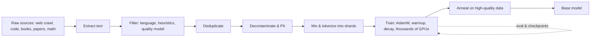

# 15. Pretraining

!!! abstract "In this chapter"
    **Prerequisites:** [Ch. 7](../nn/backprop.md) (the $6N$ rule), [Ch. 10](../transformer/tokenization.md), [Ch. 14](../transformer/gpt.md). **You will learn:** the end-to-end pretraining pipeline; where trillions of tokens come from and how web text is cleaned (extraction, language ID, heuristic filters, MinHash deduplication with a proof of the key identity, model-based quality filtering, decontamination); data mixtures, annealing and mid-training; exact FLOP accounting and model FLOPs utilization (MFU); what goes wrong in real runs; what a base model is and how to prompt it; and how base models are evaluated.
    **Why it matters:** architecture is now largely standardized. The differences between frontier models come mostly from **data** and **scale**, and pretraining is where nearly all of the compute is spent.

!!! watch "Watch"
    Andrej Karpathy, [Deep Dive into LLMs like ChatGPT](https://www.youtube.com/watch?v=7xTGNNLPyMI) (3.5 h, 2025). The first hour covers pretraining data (FineWeb), tokenization, and what a base model is.

    <div class="video"><iframe src="https://www.youtube-nocookie.com/embed/7xTGNNLPyMI" allowfullscreen loading="lazy"></iframe></div>

    Reading: Hugging Face, [FineWeb: decanting the web for the finest text data at scale](https://huggingface.co/spaces/HuggingFaceFW/blogpost-fineweb-v1) (2024). The [Llama 3 paper](https://arxiv.org/abs/2407.21783) §3 (pretraining data and recipe) is the most detailed public account of a frontier-scale run. Stanford [CS336: Language Modeling from Scratch](https://stanford-cs336.github.io/) covers this whole Part with lecture videos.

---

## 15.1 The pipeline



A **base model** is the output: a next-token predictor over a huge text distribution. It's not yet a chat assistant (that's post-training, Ch. 21). Pretraining uses ~95–99% of all the compute of a model's development.

## 15.2 Where the tokens come from

| Model | Year | Training tokens |
|---|---|---|
| GPT-2 | 2019 | ≈10B (WebText, 40 GB) |
| GPT-3 | 2020 | 300B |
| Chinchilla | 2022 | 1.4T |
| Llama 2 | 2023 | 2T |
| Llama 3 | 2024 | 15.6T |
| DeepSeek-V3 | 2024 | 14.8T |
| Qwen3 | 2025 | 36T |

The main sources:

- **Web crawl.** [Common Crawl](https://commoncrawl.org/) has archived billions of pages every month since 2008, petabytes in total. It's the bulk of every corpus, and mostly junk: boilerplate, spam, duplicates, machine-generated text.
- **Code**: public repositories (e.g. [The Stack v2](https://arxiv.org/abs/2402.19173)). Code improves reasoning even on non-code tasks.
- **High-quality text**: Wikipedia, books, academic papers (arXiv), patents, StackExchange.
- **Math**: web pages filtered for math content (e.g. OpenWebMath, FineMath), and textbooks.
- **Multilingual** web text.
- **Synthetic data**: text generated by other models, such as rewritten web pages, textbook-style explanations (the Phi models, [Gunasekar et al., 2023](https://arxiv.org/abs/2306.11644)), and verified math and code solutions. A growing share of frontier corpora.

Llama 3's final mix: about 50% general knowledge, 25% math and reasoning, 17% code, 8% multilingual.

!!! llm "Running out of data?"
    Estimates put the stock of public, high-quality human text at a few hundred trillion tokens ([Villalobos et al., 2024](https://arxiv.org/abs/2211.04325)). Frontier runs are approaching that scale. Responses include repeating good data for several epochs (up to ~4 epochs is nearly as good as new data; [Muennighoff et al., 2023](https://arxiv.org/abs/2305.16264)), synthetic data, multimodal data, and moving compute from pretraining into RL post-training and inference-time reasoning (Ch. 22).

## 15.3 Cleaning the web

FineWeb ([Penedo et al., 2024](https://arxiv.org/abs/2406.17557)) documents a modern pipeline, each stage validated by training small models and comparing their benchmark scores:

1. **Text extraction** from HTML (e.g. with `trafilatura`), removing navigation, ads and menus. Working from raw HTML rather than Common Crawl's pre-extracted text gave noticeably better models.
2. **URL filtering** against blocklists (adult content, spam).
3. **Language identification** with a fastText classifier; keep documents with a high English score (or route by language).
4. **Heuristic quality filters**, inherited from Gopher ([Rae et al., 2021](https://arxiv.org/abs/2112.11446)) and C4 ([Raffel et al., 2020](https://arxiv.org/abs/1910.10683)): document length; mean word length; fraction of lines ending in punctuation; ratio of symbols to words; fraction of duplicated lines; presence of words like "lorem ipsum" or "javascript".
5. **Deduplication** (below).
6. **Model-based quality filtering.** FineWeb-Edu had Llama-3-70B rate 450,000 pages for educational value on a 0–5 scale, trained a small classifier on those ratings, and kept pages scoring ≥3: 1.3T tokens out of 15T. Models trained on it beat models trained on unfiltered FineWeb by a large margin on knowledge and reasoning benchmarks. DCLM ([Li et al., 2024](https://arxiv.org/abs/2406.11794)) used a fastText classifier trained to recognize instruction-like, high-quality text.
7. **PII removal** (emails, phone numbers, IP addresses) and toxicity filtering.
8. **Decontamination**: remove documents that contain benchmark test questions (by n-gram overlap), so evaluation scores measure generalization rather than memorization.

### Deduplication with MinHash

The web is massively redundant: mirrors, templates, quoted text. Duplicates waste compute and encourage memorization ([Lee et al., 2022](https://arxiv.org/abs/2107.06499)). Exact duplicates are easy (hash each document). **Near**-duplicates need a similarity measure. Represent a document as its set of word $n$-grams ("shingles") $A$. The **Jaccard similarity** of two documents is

$$
J(A,B) = \frac{|A\cap B|}{|A\cup B|}.
$$

Computing $J$ for all pairs of $10^{10}$ documents is impossible. **MinHash** compresses each set into a short signature whose agreement estimates $J$.

!!! theorem "Theorem 15.1 (MinHash)"
    Let $\pi$ be a uniformly random permutation of the universe of shingles, and $h_\pi(A) = \min_{a\in A}\pi(a)$. Then

    $$
    \Pr\big[h_\pi(A) = h_\pi(B)\big] = J(A,B).
    $$

??? proof "Proof"
    Consider the element $x^* = \argmin_{x\in A\cup B}\pi(x)$, the first element of $A\cup B$ in the random order. Since $\pi$ is uniform, $x^*$ is equally likely to be any element of $A\cup B$. If $x^*\in A\cap B$, it is the minimum of both sets, so $h_\pi(A) = h_\pi(B)$. If $x^*$ is in only one of the sets, that set's minimum is $\pi(x^*)$ and the other set's minimum is larger, so they differ. Hence the probability is $|A\cap B|/|A\cup B|$. $\blacksquare$

With $k$ independent hash functions (in practice, random hash functions approximate random permutations), the fraction of matching signature entries is an unbiased estimate of $J$ with standard deviation $\le1/(2\sqrt k)$.

**Locality-sensitive hashing (LSH)** finds candidate pairs without comparing all of them. Split the $k = br$ signature entries into $b$ bands of $r$ rows, and hash each band. Two documents become candidates if *any* band matches exactly. For a pair with similarity $s$:

$$
\Pr[\text{candidate}] = 1-(1-s^r)^b,
$$

an S-shaped curve that's near 0 for low $s$ and near 1 for high $s$. FineWeb uses 112 hashes in 14 bands of 8, which catches documents with about 75% or more similarity. (A surprising finding from FineWeb: deduplicating *across* all crawl snapshots globally hurt quality, because it mostly removed good content that recurs, leaving behind unique junk. Deduplicating within each snapshot worked better.)

## 15.4 Mixtures, curricula and annealing

- **Mixture weights.** How much code vs web vs math? Teams tune proportions with small proxy models and scaling-law fits ([Ye et al., Data Mixing Laws, 2024](https://arxiv.org/abs/2403.16952)), and upsample high-quality sources.
- **Annealing.** During the final phase of the learning-rate decay (§5.7), switch to a higher-quality mixture. Llama 3 annealed the last 40M tokens on upsampled high-quality sources. Since the loss falls fastest during decay, this gives the best data the most influence. With WSD schedules, this decay phase is natural.
- **Mid-training**: a phase between pretraining and post-training (long documents for context extension, reasoning data, instruction-formatted data, multiple-choice questions) that prepares the base model for post-training.
- **Context-length schedule.** Train most tokens at a short context (4K–8K), then extend to 32K–128K+ for the last few percent with RoPE rescaling (§11.6). Attention cost makes long-context training expensive per token.

## 15.5 Compute accounting and MFU

Training compute is $C\approx6ND$ (Prop. 7.4). Kaplan et al. give the refined forward cost per token, including attention:

$$
C_\text{forward}\approx 2N + 2\,L\,T\,d.
$$

(Their accounting: $2N$ for the weight matmuls, $2LTd$ for the score and weighted-sum matmuls with the causal half removed.) The training cost is about 3× that per token.

!!! definition "Definition 15.1 (Model FLOPs Utilization, MFU)"
    $$
    \text{MFU} = \frac{\text{model FLOPs per token}\times\text{tokens processed per second}}{\text{number of GPUs}\times\text{peak FLOP/s per GPU}}.
    $$

    "Model FLOPs" counts only the FLOPs the algorithm requires (e.g. $6N$ per token), not recomputation. MFU measures how well the whole system turns hardware into training progress ([Chowdhery et al., PaLM, 2022](https://arxiv.org/abs/2204.02311)).

Typical large-scale MFU is 35–55%. The rest goes to memory-bound operations (norms, softmax, elementwise ops), communication between GPUs, pipeline bubbles, and failures.

!!! theorem "Worked example (Llama 3 405B)"
    $N = 405\times10^9$, $D = 15.6\times10^{12}$: $C\approx6\cdot405\times10^9\cdot15.6\times10^{12}\approx3.8\times10^{25}$ FLOPs (Meta reports exactly this figure).

    An H100's dense bf16 peak is about $989\times10^{12}$ FLOP/s. At 40% MFU, one GPU does $\approx4\times10^{14}$ useful FLOP/s, so the run needs $\approx9.6\times10^{10}$ GPU-seconds ≈ 26.7M GPU-hours. On 16,384 GPUs that's about 68 days. (Meta reports 38–43% MFU and roughly 31M H100-hours for the 405B model.)

## 15.6 What goes wrong

At thousands of GPUs, failure is the normal case. During a 54-day snapshot of Llama 3 405B training there were **466 job interruptions**, about 78% from hardware (GPU failures, HBM memory errors, network switches). Practices that make runs survivable:

- **Frequent checkpoints** and fast automatic restarts. Every interruption loses the work since the last checkpoint.
- **Loss spikes**: the loss suddenly jumps. Usual responses are to roll back to a checkpoint before the spike, skip the data batches around it, and sometimes lower the learning rate ([PaLM](https://arxiv.org/abs/2204.02311) §5.1). Prevention: the stability tricks of §8.6 (QK-norm, z-loss, $\beta_2 = 0.95$, clipping).
- **Silent data corruption**: hardware occasionally computes wrong results without any error. Detect it by monitoring for numerical anomalies, and by checking that replicas that should agree actually do.
- **Monitor everything**: loss, gradient norm, per-layer activation and weight norms, throughput, and small evaluation benchmarks every few thousand steps.

## 15.7 What a base model is

A base model continues documents. Ask it a question and it may continue with more questions (as if it were in a list of FAQs), or answer in the style of a forum post. It has knowledge and skills, but it isn't trying to help you. You steer it by making the desired output the most likely continuation:

```text
The following is a transcript of a conversation between a helpful, knowledgeable assistant and a user.

User: What causes the seasons on Earth?
Assistant:
```

or with **few-shot** examples showing the format (GPT-3's central finding, [Brown et al., 2020](https://arxiv.org/abs/2005.14165)):

```text
English: cheese -> French: fromage
English: house -> French: maison
English: sea otter -> French:
```

Base models are also **well calibrated** (§4.10) and more **diverse** than chat models, which is why they're useful for generating varied synthetic data and as the starting point for every post-training method.

## 15.8 Evaluating base models

- **Held-out loss / perplexity / bits-per-byte** on clean validation text, the most precise signal of pretraining progress (§4.7).
- **Benchmarks**, usually few-shot:
    - knowledge: MMLU ([Hendrycks et al., 2021](https://arxiv.org/abs/2009.03300)), 57 subjects of multiple-choice questions;
    - commonsense: HellaSwag, ARC, WinoGrande, PIQA;
    - math: GSM8K, MATH;
    - code: HumanEval, MBPP.
- **How multiple-choice is scored** matters. Either compare the model's log-probabilities of each answer's text (normalized by length), or ask for the letter "A/B/C/D". Small models do much better with the first; large ones handle both.
- **Contamination**: if benchmark questions were in the training data, scores are inflated. Decontaminate training data (§15.3), and prefer newer or held-out benchmarks.

Benchmarks saturate quickly (MMLU went from ~44% for GPT-3 to ~90% within four years), so the field keeps moving to harder ones (Ch. 29).

## Key takeaways

- Pretraining = next-token prediction on trillions of filtered, deduplicated tokens. It produces a base model that continues documents.
- Data quality is a first-order lever: extraction, heuristic and model-based filtering (FineWeb-Edu, DCLM), and MinHash deduplication.
- MinHash: $\Pr[\text{min-hashes agree}] = $ Jaccard similarity. LSH banding finds near-duplicate pairs at web scale.
- Compute $C\approx6ND$. MFU = useful FLOPs / peak FLOPs, typically 35–55%. Llama 3 405B: $3.8\times10^{25}$ FLOPs.
- Real runs face constant hardware failures and occasional loss spikes: checkpoint, monitor, roll back.
- Annealing on high-quality data and mid-training phases bridge pretraining and post-training.

## Exercises

1. Prove that the MinHash estimator with $k$ independent hashes has variance $J(1-J)/k$.
2. For LSH with $b = 14$ bands of $r = 8$, compute the candidate probability for $s = 0.5$, $0.75$, $0.9$.
3. A 70B model is trained on 15T tokens on 8,192 H100s at 45% MFU. How long does it take?
4. Why might deduplicating across all of Common Crawl globally *lower* data quality (FineWeb's finding)?
5. Write a few-shot prompt that gets a base model to classify the sentiment of movie reviews into "positive" or "negative".
6. **Code:** implement MinHash with 128 hash functions (e.g. `hash((seed, shingle))`) on 5-word shingles, and check that the estimated similarity of two overlapping paragraphs matches the exact Jaccard similarity.

??? success "Solutions"
    1. Each agreement indicator is Bernoulli($J$) (Thm 15.1), with variance $J(1-J)$. The average of $k$ independent ones has variance $J(1-J)/k\le1/(4k)$.
    2. $1-(1-s^8)^{14}$: $s = 0.5$: $1-(1-0.0039)^{14}\approx0.053$; $s = 0.75$: $1-(1-0.100)^{14}\approx0.77$; $s = 0.9$: $1-(1-0.430)^{14}\approx0.9996$.
    3. $C = 6\cdot70\times10^9\cdot15\times10^{12} = 6.3\times10^{24}$. Throughput $8192\cdot0.45\cdot989\times10^{12}\approx3.65\times10^{18}$ FLOP/s, so about $1.73\times10^6$ s ≈ 20 days.
    4. Content that recurs across many snapshots tends to be good (popular, maintained pages), and removing all but one copy shifts the remaining mixture toward pages that appear once, which are disproportionately low quality.
    5. Give 3–4 examples of `Review: ... Sentiment: positive/negative`, then the new review and `Sentiment:`, and compare the probabilities of " positive" and " negative".
    6. With 128 hashes, estimates should be within about ±0.05 of the exact value.

## References

- G. Penedo et al., [The FineWeb Datasets: Decanting the Web for the Finest Text Data at Scale](https://arxiv.org/abs/2406.17557) (NeurIPS 2024).
- J. Li et al., [DataComp-LM: In search of the next generation of training sets for language models](https://arxiv.org/abs/2406.11794) (2024).
- A. Broder, [On the resemblance and containment of documents](https://ieeexplore.ieee.org/document/666900) (1997), the origin of MinHash; J. Leskovec, A. Rajaraman, J. Ullman, [*Mining of Massive Datasets*](http://www.mmds.org/), Ch. 3 (MinHash and LSH).
- K. Lee et al., [Deduplicating Training Data Makes Language Models Better](https://arxiv.org/abs/2107.06499) (ACL 2022).
- Llama Team, Meta, [The Llama 3 Herd of Models](https://arxiv.org/abs/2407.21783) (2024).
- DeepSeek-AI, [DeepSeek-V3 Technical Report](https://arxiv.org/abs/2412.19437) (2024).
- A. Chowdhery et al., [PaLM: Scaling Language Modeling with Pathways](https://arxiv.org/abs/2204.02311) (2022).
