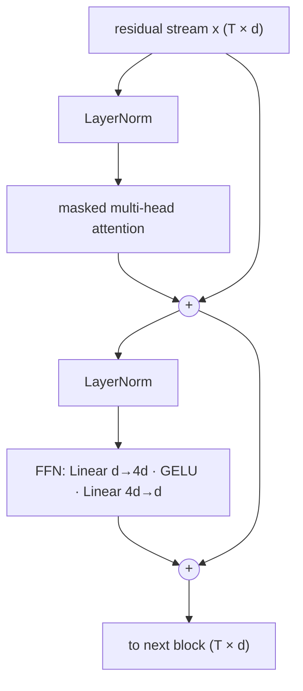

# 13. The Transformer Block

!!! abstract "In this chapter"
    **Prerequisites:** [Ch. 6](../nn/mlp.md) (MLPs), [Ch. 8](../nn/training.md) (residuals, normalization, init), [Ch. 12](attention.md). **You will learn:** the anatomy of a pre-norm decoder block ("communicate, then compute"), the feed-forward network and its gated SwiGLU variant (with the $\frac83d$ derivation), an exact parameter count of GPT-2 small down to the last parameter, the FLOPs and activation memory of a block, the residual stream as a communication channel and the logit lens, and the encoder/decoder family tree.
    **Why it matters:** an LLM is this block repeated $L$ times between an embedding and an output head. Once you understand one block, you understand the whole network's structure; everything else is width, depth and data.

!!! watch "Watch"
    Andrej Karpathy, [Let's build GPT: from scratch, in code, spelled out](https://www.youtube.com/watch?v=kCc8FmEb1nY) (from "multi-headed self-attention" onward, he assembles exactly this block).

    <div class="video"><iframe src="https://www.youtube-nocookie.com/embed/kCc8FmEb1nY" allowfullscreen loading="lazy"></iframe></div>

    3Blue1Brown, [How might LLMs store facts](https://www.youtube.com/watch?v=9-Jl0dxWQs8) (Deep Learning Ch. 7), on the MLP half of the block. Brendan Bycroft's [LLM Visualization](https://bbycroft.net/llm) shows every tensor of a GPT block in 3-D.

---

## 13.1 Anatomy of a block

A GPT-style (pre-norm, decoder-only) block maps the residual stream $\mathbf{X}\in\R^{T\times d}$ to a new one of the same shape:

$$
\begin{aligned}
\mathbf{X}' &= \mathbf{X} + \operatorname{MHA}\big(\operatorname{LN}_1(\mathbf{X})\big) &&\text{communicate: tokens exchange information}\\
\mathbf{X}'' &= \mathbf{X}' + \operatorname{FFN}\big(\operatorname{LN}_2(\mathbf{X}')\big) &&\text{compute: each token processes what it gathered}
\end{aligned}
$$



```python
--8<-- "code/gpt.py:block"
```

Each of the two sub-layers *reads* a normalized copy of the stream and *adds* its result back. Neither overwrites the stream. That gives the identity gradient path of Proposition 8.4 through all $2L$ sub-layers, and it's why pre-norm Transformers train stably at depth (§8.4).

The full model is: embeddings → $L$ blocks → final LayerNorm → output projection to $V$ logits.

$$
\mathbf{H}^{(0)} = \mathbf{E}[\mathbf{x}]+\mathbf{P}_{1:T},\qquad \mathbf{H}^{(\ell)} = \operatorname{Block}_\ell(\mathbf{H}^{(\ell-1)}),\qquad \mathbf{Z} = \operatorname{LN}_f(\mathbf{H}^{(L)})\,\mathbf{E}^\top\in\R^{T\times V}.
$$

## 13.2 The feed-forward network

The FFN is a 2-layer MLP applied to every position separately (§6.7):

$$
\operatorname{FFN}(\mathbf{x}) = \mathbf{W}_2\,\operatorname{GELU}(\mathbf{W}_1\mathbf{x}+\mathbf{b}_1)+\mathbf{b}_2,\qquad\mathbf{W}_1\in\R^{4d\times d},\ \mathbf{W}_2\in\R^{d\times4d}.
$$

```python
--8<-- "code/gpt.py:mlp"
```

The hidden layer is 4× wider than the stream. Attention moves information between positions. The FFN transforms it: it detects features in the gathered information (rows of $\mathbf{W}_1$ as "keys") and writes associated outputs back (columns of $\mathbf{W}_2$ as "values"), as in the key-value memory view (Geva et al., §6.7).

### Gated FFNs: SwiGLU

[Shazeer, GLU Variants Improve Transformer](https://arxiv.org/abs/2002.05202) (2020) replaced the FFN with a **gated linear unit**: two parallel up-projections, one passed through an activation and used to *gate* the other elementwise.

$$
\operatorname{SwiGLU}(\mathbf{x}) = \mathbf{W}_2\big(\operatorname{SiLU}(\mathbf{W}_1\mathbf{x})\odot\mathbf{W}_3\mathbf{x}\big),\qquad \mathbf{W}_1,\mathbf{W}_3\in\R^{d_\text{ff}\times d},\ \mathbf{W}_2\in\R^{d\times d_\text{ff}}.
$$

```python
--8<-- "code/llama.py:swiglu"
```

!!! theorem "Proposition 13.1 (The $\frac83d$ hidden size)"
    A SwiGLU FFN with hidden size $d_\text{ff} = \frac83d$ has the same number of parameters as a standard FFN with hidden size $4d$.

??? proof "Proof"
    Standard: two matrices of size $4d\times d$, so $8d^2$. SwiGLU: three matrices of size $d_\text{ff}\times d$, so $3d\,d_\text{ff}$. Setting $3d\,d_\text{ff} = 8d^2$ gives $d_\text{ff} = \frac83d$. $\blacksquare$

    In practice the size is rounded up to a multiple of 256 or so for hardware efficiency, and often enlarged. Llama 2 7B: $d = 4096$, $\frac83d\approx10{,}923\to11{,}008$. Llama 3 8B uses $14{,}336 = 3.5d$.

**Why gating helps.** The product $\operatorname{SiLU}(\mathbf{w}_1^\top\mathbf{x})\cdot(\mathbf{w}_3^\top\mathbf{x})$ is a *multiplicative* interaction between two learned features of the input: one decides *whether* to pass a signal, the other *what* signal. That's more expressive per parameter than a single activation, and SwiGLU consistently gives lower loss at equal compute. Shazeer's paper ends with the much-quoted line: "We offer no explanation as to why these architectures seem to work; we attribute their success, as all else, to divine benevolence." Nearly every modern LLM uses SwiGLU or GeGLU.

## 13.3 Counting every parameter of GPT-2 small

Configuration: $V = 50{,}257$, $T_\max = 1024$, $L = 12$, $d = 768$, $H = 12$, biases on, embeddings tied.

| Component | Shape | Parameters |
|---|---|---|
| token embedding `wte` (tied with output) | $50257\times768$ | 38,597,376 |
| position embedding `wpe` | $1024\times768$ | 786,432 |
| **per block:** `ln_1` (γ, β) | $2\times768$ | 1,536 |
| `attn.c_attn` ($\mathbf{W}_{QKV}$ + bias) | $768\times2304+2304$ | 1,771,776 |
| `attn.c_proj` ($\mathbf{W}_O$ + bias) | $768\times768+768$ | 590,592 |
| `ln_2` | $2\times768$ | 1,536 |
| `mlp.c_fc` | $768\times3072+3072$ | 2,362,368 |
| `mlp.c_proj` | $3072\times768+768$ | 2,360,064 |
| **block total** | $12d^2+13d$ | 7,087,872 |
| 12 blocks | | 85,054,464 |
| final `ln_f` | $2\times768$ | 1,536 |
| **total** | | **124,439,808** |

!!! theorem "Proposition 13.2 (Parameters per block)"
    A GPT-2 block has $12d^2+13d$ parameters: $4d^2+4d$ for attention, $8d^2+5d$ for the FFN, and $4d$ for the two LayerNorms. For large $d$ this is $\approx12d^2$, and a model with $L$ layers has $N\approx12Ld^2$ non-embedding parameters.

??? proof "Proof"
    Attention: $\mathbf{W}_{QKV}$ is $3d^2+3d$ and $\mathbf{W}_O$ is $d^2+d$. FFN: $4d^2+4d$ and $4d^2+d$. Two LayerNorms: $2\times2d$. Total $12d^2+(3+1+4+1+4)d = 12d^2+13d$. $\blacksquare$

The test suite instantiates `GPT(GPTConfig())` and checks the count. Two-thirds of each block ($8d^2$ of $12d^2$) is FFN. The formula $N\approx12Ld^2$ is the one used in scaling-law calculations (Ch. 17): GPT-3 175B has $L = 96$, $d = 12{,}288$, so $12\cdot96\cdot12288^2\approx1.74\times10^{11}$. ✓

## 13.4 Compute and memory of a block

**FLOPs per token, forward** (using $2$ FLOPs per multiply-add, Fact 1.6): the weight matmuls cost $2\times12d^2 = 24d^2$, and attention scores and the weighted sum cost $4Td$ (with $T$ the context length; halved on average with a causal mask). Across $L$ layers, the forward pass costs $\approx2N + 4LTd$ FLOPs per token, and training is 3× that (§7.6). Kaplan et al. ([2020](https://arxiv.org/abs/2001.08361), Table 1) use exactly this accounting.

**Activation memory per block** for training (what must be kept for the backward pass), from [Korthikanti et al., 2022](https://arxiv.org/abs/2205.05198), in 16-bit precision without recomputation:

$$
\text{bytes per block}\approx T\,B\,d\,\Big(34 + 5\frac{HT}{d}\Big).
$$

The $5HT/d$ term is the $T\times T$ attention scores, softmax output and dropout mask. It's quadratic in $T$, and FlashAttention removes it (Ch. 19). For GPT-3-sized models at $T = 2048$ this term dominates, which is why fused attention and selective recomputation are standard.

## 13.5 The residual stream view

Because blocks only add to the stream, the final hidden state is a **sum** of contributions:

$$
\mathbf{h}^{(L)}_t = \mathbf{h}^{(0)}_t + \sum_{\ell=1}^L\Big(\operatorname{attn}_\ell(\cdot)_t+\operatorname{ffn}_\ell(\cdot)_t\Big),
$$

and the logits are (nearly) linear in this sum: $\mathbf{z}_t = \mathbf{E}\,\operatorname{LN}_f(\mathbf{h}^{(L)}_t)$. You can therefore ask what each component *contributes* to the final prediction.

- The **logit lens** ([nostalgebraist, 2020](https://www.lesswrong.com/posts/AcKRB8wDpdaN6v6ru/interpreting-gpt-the-logit-lens)): apply the final LayerNorm and unembedding to an *intermediate* stream $\mathbf{h}^{(\ell)}_t$. Often the correct next token rises to the top gradually through the middle layers: the model refines its guess layer by layer. The **tuned lens** ([Belrose et al., 2023](https://arxiv.org/abs/2303.08112)) learns a small correction per layer for a more faithful reading.
- **Direct logit attribution**: project each head's or MLP's output onto the unembedding direction of a token to see how much it pushed that token up or down.

These tools are the starting point of mechanistic interpretability (Ch. 24).

## 13.6 Variations on the block

- **Post-norm** (original Transformer, BERT): $\operatorname{LN}(\mathbf{x}+\operatorname{sublayer}(\mathbf{x}))$. Harder to train deep (§8.4).
- **Parallel block** (GPT-J, PaLM): $\mathbf{x}+\operatorname{MHA}(\operatorname{LN}(\mathbf{x}))+\operatorname{FFN}(\operatorname{LN}(\mathbf{x}))$. Attention and FFN read the same normalized input, so their input matmuls can be fused. About 15% faster training at large scale with a small quality cost at small scale ([Chowdhery et al., 2022](https://arxiv.org/abs/2204.02311)).
- **Llama-style** (Ch. 20): RMSNorm instead of LayerNorm, no biases, RoPE inside attention, SwiGLU FFN, grouped-query attention.
- **Extra norms**: QK-norm inside attention, and "sandwich" norms after each sub-layer as well as before (Gemma 2/3, OLMo 2), for stability at scale.
- **Mixture of experts** (Ch. 20): the FFN is replaced by many FFN "experts", of which a router selects a few per token.

## 13.7 Encoders, decoders, and why decoder-only won

| Family | Attention | Objective | Examples |
|---|---|---|---|
| Encoder-only | bidirectional (no mask) | masked LM: predict ~15% masked tokens | BERT, RoBERTa; embedding models (Ch. 26) |
| Encoder–decoder | bidirectional encoder + causal decoder with cross-attention | span corruption, translation | original Transformer, T5, BART, Whisper |
| **Decoder-only** | causal | next-token prediction | GPT, Llama, Claude, Gemini, DeepSeek, Qwen |

Decoder-only won for general-purpose LLMs because (a) next-token prediction uses *every* token as a training signal (BERT trains on only the ~15% masked ones), (b) one architecture handles both understanding and generation, with every task framed as text continuation, (c) prompts and responses share one KV cache, and (d) it scales predictably. Encoders remain the standard for embeddings and classification.

## Key takeaways

- Block = `x + attn(LN(x))` then `x + ffn(LN(x))`: communicate across positions, then compute per position, always *adding* to the residual stream.
- FFN: $d\to4d\to d$ with GELU. SwiGLU uses three matrices with $d_\text{ff}\approx\frac83d$ for equal parameters and better loss.
- Parameters per block $\approx12d^2$ (2/3 in the FFN). GPT-2 small has exactly 124,439,808 parameters with tied embeddings.
- Forward FLOPs per token ≈ $2N + 4LTd$. Activation memory has a $T^2$ term that fused attention removes.
- The residual stream is a sum of component outputs. The logit lens reads intermediate predictions.
- Decoder-only with causal attention is the architecture of every frontier LLM.

## Exercises

1. Compute the parameter count of GPT-2 medium ($L = 24$, $d = 1024$) and GPT-2 XL ($L = 48$, $d = 1600$), with $V = 50{,}257$, $T_\max = 1024$, tied embeddings.
2. For Llama 3 8B ($d = 4096$, $L = 32$, $H = 32$, $H_{kv} = 8$, $d_h = 128$, $d_\text{ff} = 14336$, $V = 128{,}256$, untied, no biases, RMSNorm), count parameters per block and in total.
3. Show that with the parallel block, the first matmuls of attention and the FFN can be done as one matmul. What are the shapes?
4. Why does the FFN act on each position independently? What would break if it mixed positions?
5. Using Korthikanti's formula, compare the activation memory per block for $T = 2048$ and $T = 32{,}768$ at $B = 1$, $d = 4096$, $H = 32$.
6. **Code:** implement the logit lens for the trained char-level GPT from Ch. 14: for a fixed prompt, decode the most likely next character from the stream after each block.

??? success "Solutions"
    1. Medium: $24(12\cdot1024^2+13\cdot1024)+50257\cdot1024+1024\cdot1024+2\cdot1024\approx354.8$M (usually quoted as 350M). XL: $48(12\cdot1600^2+13\cdot1600)+50257\cdot1600+1024\cdot1600+3200\approx1.558$B (quoted as 1.5B).
    2. Attention: $\mathbf{W}_Q$ $4096^2$, $\mathbf{W}_K,\mathbf{W}_V$ $4096\times1024$ each, $\mathbf{W}_O$ $4096^2$: $41.9$M. SwiGLU: $3\times4096\times14336 = 176.2$M. Norms $2\times4096$. Per block ≈ 218.1M; ×32 = 6.98B; embeddings + output $2\times128256\times4096 = 1.05$B; total ≈ 8.03B.
    3. Concatenate $[\mathbf{W}_{QKV};\mathbf{W}_1]$ into one $(3d+4d)\times d$ matrix applied to $\operatorname{LN}(\mathbf{x})$, then split the output.
    4. Mixing positions in the FFN would need a causal structure again (to avoid seeing the future) and would duplicate attention's role. Keeping it per position makes it a large, parallel, token-wise computation.
    5. $T = 2048$: $2048\cdot4096\cdot(34+5\cdot32\cdot2048/4096) = 2048\cdot4096\cdot114\approx0.96$ GB. $T = 32768$: $32768\cdot4096\cdot(34+1280)\approx176$ GB. Without fused attention, long context is impossible.
    6. Apply `model.transformer.ln_f` and `model.lm_head` to the hidden state after each block.

## References

- A. Vaswani et al., [Attention Is All You Need](https://arxiv.org/abs/1706.03762) (2017).
- A. Radford et al., [Language Models are Unsupervised Multitask Learners](https://cdn.openai.com/better-language-models/language_models_are_unsupervised_multitask_learners.pdf) (GPT-2, 2019).
- N. Shazeer, [GLU Variants Improve Transformer](https://arxiv.org/abs/2002.05202) (2020).
- J. Kaplan et al., [Scaling Laws for Neural Language Models](https://arxiv.org/abs/2001.08361) (2020), §2.1 (parameter and FLOP accounting).
- V. Korthikanti et al., [Reducing Activation Recomputation in Large Transformer Models](https://arxiv.org/abs/2205.05198) (2022).
- N. Elhage et al., [A Mathematical Framework for Transformer Circuits](https://transformer-circuits.pub/2021/framework/index.html) (2021).
- J. Devlin et al., [BERT](https://arxiv.org/abs/1810.04805) (2019); C. Raffel et al., [T5](https://arxiv.org/abs/1910.10683) (2020).
